# Auditoria independente reproduzível: 2º turno presidencial de 2026

Repositório com scripts, previsões pré-registradas, resultados e documentação de uma auditoria estatística dos dados oficiais do TSE sobre o 2º turno de 25/10/2026 (Lula x Flávio Bolsonaro). **Não é laudo, perícia oficial nem documento homologado.**

Portal: https://baduba.github.io/eleicoes-dossie-2026/ (após a publicação) · PDF: `relatorio/` e release v0.9.3 (versão preliminar).

**Versão preliminar (v0.9.3).** A v1.0 sai depois do relatório consolidado do TCU (até 24/11/2026), da verificação da assinatura e de um lote inicial de boletins impressos.

## O que sabemos e o que ainda não sabemos

### Resultado verificado

- **Cadeia RDV, BU, BWeb e total:** 0 divergências nos testes executados (14.067 seções de 27 UFs com arquivos de urna; BWeb contra totalização por seção, município e zona).
- **Excesso medido somado:** cerca de 99 mil pró-Lula e 101 mil pró-Flávio (votos de margem), em sentidos opostos, contra a margem de 4.430.191 votos.
- **Votos depois das 17h:** cerca de 23 mil (contagem de votos, não votos de margem).
- **Limite:** esses testes comparam arquivos que o próprio TSE publica; não excluem uma alteração coerente feita antes da publicação nem verificam se o voto registrado é o digitado (ver as perguntas abaixo).

Os testes cobrem o que o TSE publica, e aí o resultado é zero divergências. Se uma alteração acontecesse nos elos que não são publicados (o voto digitado, o boletim impresso, a transmissão), nenhum teste deste dossiê a veria. É por isso que as perguntas abaixo continuam abertas.

## Perguntas em aberto: o que os testes não conseguiram explicar nem confirmar

**Não são evidências de manipulação. São lacunas. Se você tem dados ou método para fechar alguma, contribua.**

Cada cartão traz a pergunta, a situação, a direção do efeito (a favor de quem, se houver), o teto em votos de margem com a ressalva na mesma linha e o que fecharia a questão. Dentro de cada bloco, a ordem é pelo tamanho do que a resposta poderia mudar (maior teto ou maior ponto cego primeiro). Os tetos são limites superiores sob o pior caso; a margem é de 4.430.191 votos de margem.

### a) Resíduos sem causa identificada (testes executados, inconclusivos)

> **Nas seções com mais eleitores de 80 anos ou mais, a participação de Lula e de Flávio difere da dos anos anteriores?**  
> Situação: **TESTADO-INCONCLUSIVO** · Direção: a favor de Lula (teto) ou de Flávio (lado simétrico)  
> Teto: **teto de pior caso, não estimativa: 1.787.533 votos de margem (40,35% da margem)** (o coeficiente de 2026 fica dentro do intervalo dos placebos e a estimativa central é negativa para Lula; o teto vem da dispersão entre os anos de comparação; o lado a favor de Flávio tem teto de 790.398)  
> O que fecharia: Mais anos de comparação com o perfil do eleitorado por seção e as listas de habilitação das seções com mais idosos.  
> [Página técnica](https://baduba.github.io/eleicoes-dossie-2026/fase3.html#a20b) · [Abrir issue](https://github.com/baduba/eleicoes-dossie-2026/issues/new?title=A-A20b-part%20A-A20b-part)

> **Onde há mais liberação manual de eleitor, Lula vai melhor? O teste não tem precisão para responder.**  
> Situação: **TESTADO-INCONCLUSIVO** · Direção: a favor de Lula  
> Teto: **teto de pior caso, não estimativa: 1.337.198 votos de margem (30,18% da margem)** (teto vem da imprecisão do teste, sem efeito medido)  
> O que fecharia: Listas assinadas de habilitação por seção (folhas de votação) e o log de todas as seções, não só da amostra.  
> [Página técnica](https://baduba.github.io/eleicoes-dossie-2026/residuos.html) · [Abrir issue](https://github.com/baduba/eleicoes-dossie-2026/issues/new?title=A-H1-S0%20A-H1-S0)

> **O voto para presidente combina com o voto para governador na mesma seção, como em 2022 e 2018?**  
> Situação: **TESTADO-INCONCLUSIVO** · Direção: a favor de Flávio ou de Lula (lados simétricos)  
> Teto: **teto de pior caso, não estimativa: 548.671 votos de margem (12,38% da margem)** (variante exploratória (Adendo 9b), só AM e DF, pouco poder; vale só para os votos dessas duas UFs; o lado a favor de Lula tem teto de 169.390; a linha oficial de A22 é NÃO EXECUTÁVEL (nenhuma UF elegível pela regra registrada))  
> O que fecharia: Os votos por candidato em todos os cargos por seção nas 27 UFs, com uma regra de alinhamento definida por quem conhece as alianças locais; ou deputados federais por partido nas UFs sem 2º turno de governador.  
> [Página técnica](https://baduba.github.io/eleicoes-dossie-2026/fase3.html#a22) · [Abrir issue](https://github.com/baduba/eleicoes-dossie-2026/issues/new?title=A-A22%20A-A22)

> **Há mais eleitores muito idosos aptos e votando do que a população do Censo comportaria?**  
> Situação: **TESTADO-INCONCLUSIVO** · Direção: sem direção identificável  
> Teto: **teto de pior caso, não estimativa: 459.099 votos de margem (10,36% da margem)** (o teto é o comparecimento 80+ acima das taxas de 2022; o mesmo aumento aparece nas faixas de 70 a 79 anos)  
> O que fecharia: Cruzamento do cadastro com o registro civil de óbitos, por entidade fiscalizadora; perfil do eleitorado por seção, não só por zona.  
> [Página técnica](https://baduba.github.io/eleicoes-dossie-2026/fase3.html#a20) · [Abrir issue](https://github.com/baduba/eleicoes-dossie-2026/issues/new?title=A-A20%20A-A20)

> **A duração do voto, da habilitação à confirmação, é compatível com um eleitor presente em cada seção? A regra do percentil 99 acusa excesso em 2026, mas a composição da cédula explica quase tudo.**  
> Situação: **TESTADO-INCONCLUSIVO** · Direção: sem direção identificável  
> Teto: **teto de pior caso, não estimativa: 339.311 votos de margem (7,66% da margem)** (teto extrapolado do excesso de 0,24 ponto percentual sobre 1% (cerca de 16 seções em 6.667 de UFs com a mesma composição de cédula) para as 497.897 seções, com todo o voto lido como de um lado: **inflado por construção, não plotado no G3**; no fator 1 da amostra são 23.093 votos de margem; pela regra registrada, 2,06% das seções de 2026/2º turno têm D3 acima do percentil 99 de 2022 contra 1% esperado (excesso de forma), que cai para 1,24% nas UFs de mesma composição (diagnóstico pós-hoc); a previsão do pré-registro para a mediana (40 s a 2 min) estava errada (a mediana é de 9 s); mediana e modelos de associação sem excesso)  
> O que fecharia: Logs de todas as seções (poder), uma lista oficial das UFs com segundo turno estadual em cada ano (para fixar a composição da cédula sem usar o desfecho) e o log com todos os cargos.  
> [Página técnica](https://baduba.github.io/eleicoes-dossie-2026/fase3.html#a34) · [Abrir issue](https://github.com/baduba/eleicoes-dossie-2026/issues/new?title=A-A34%20A-A34)

> **Nas seções com mais eleitores de 80 anos ou mais, o comparecimento do 2º turno sobe mais do que em 2022 e 2018?**  
> Situação: **TESTADO-INCONCLUSIVO** · Direção: sem direção identificável  
> Teto: **teto de pior caso, não estimativa: 241.008 votos de margem (5,44% da margem)** (linha suplementar do Adendo 9d (só placebos com o mesmo controle); a linha original, com um comparador de outra especificação, dá 4,07 milhões; o coeficiente de participação de Lula nessas seções é negativo)  
> O que fecharia: Listas assinadas de habilitação das seções com mais idosos e o cruzamento do cadastro com o registro civil de óbitos, por entidade fiscalizadora.  
> [Página técnica](https://baduba.github.io/eleicoes-dossie-2026/fase3.html#a20b) · [Abrir issue](https://github.com/baduba/eleicoes-dossie-2026/issues/new?title=A-A20b%20A-A20b)

> **Por que 748 dos 5.357 municípios (14,0%) tiveram o ganho de Flávio entre os turnos de +1 voto ou menos, quase todos no Nordeste e no Norte?**  
> Situação: **TESTADO-INCONCLUSIVO** · Direção: sem direção identificável  
> Teto: **teto de pior caso, não estimativa: 234.746 votos de margem (5,30% da margem)** (a fração de 14,0% é compatível com o crescimento nacional do oponente em 2026 (esperado de 13,2% a 15,4% com 2018 e 2022 deslocados); 70,6% desses municípios tiveram queda de comparecimento; o teto é todo o déficit de Flávio em relação ao crescimento da UF atribuído a troca de voto, e o excedente sobre o que o deslocamento nacional reproduz é 0; **o teste não distingue troca de voto de abstenção seletiva**)  
> O que fecharia: Boletins impressos das seções dos 20 municípios com maior perda de Flávio (lista em `results/fase3/A31b_20_secoes.csv`) e as listas de habilitação.  
> [Página técnica](https://baduba.github.io/eleicoes-dossie-2026/fase3.html#a31b) · [Abrir issue](https://github.com/baduba/eleicoes-dossie-2026/issues/new?title=A-A31b%20A-A31b)

> **Por que o coeficiente de 2026 da liberação manual da escola sobre o ganho de Lula (-0,017) é mais negativo que o do placebo de 2022 (-0,002)?**  
> Situação: **TESTADO-INCONCLUSIVO** · Direção: sem direção identificável  
> Teto: **teto de pior caso, não estimativa: 221.830 votos de margem (5,01% da margem)** (**causa não identificada**; o sentido é o oposto ao do esquema pré-registrado (mais liberação manual, menos ganho de Lula e menos comparecimento), o placebo de 2018 tem o mesmo sinal negativo, e nenhum teste de excesso passa em Holm; o teto vem da incerteza do coeficiente multiplicada pela exposição, não de um efeito medido, e por isso **não é plotado no G3** (regra de exibição, CHANGELOG))  
> O que fecharia: A abstenção por faixa etária e por seção do 2º turno (produto do TSE ainda não publicado) e a composição das escolas (rural, idade) para separar efeito de composição de efeito da liberação manual.  
> [Página técnica](https://baduba.github.io/eleicoes-dossie-2026/fase3.html#a33) · [Abrir issue](https://github.com/baduba/eleicoes-dossie-2026/issues/new?title=A-A33-placebo%20A-A33-placebo)

> **Urnas do modelo mais novo (UE2022) votam diferente das demais dentro do mesmo local?**  
> Situação: **TESTADO-INCONCLUSIVO** · Direção: a favor de Lula  
> Teto: excesso medido: 56.317 votos de margem; **teto de pior caso, não estimativa: 137.809 votos de margem (3,11% da margem)**  
> O que fecharia: Mais seções com o modelo novo em 2022 para servir de comparação, ou o código de carga por urna (pedido LAI 02).  
> [Página técnica](https://baduba.github.io/eleicoes-dossie-2026/resultados-fase2.html#a10) · [Abrir issue](https://github.com/baduba/eleicoes-dossie-2026/issues/new?title=A-A10%20A-A10)

> **Onde há mais liberação manual, Flávio vai melhor do que no 1º turno prevê?**  
> Situação: **TESTADO-INCONCLUSIVO** · Direção: a favor de Flávio  
> Teto: excesso medido: 101.285 votos de margem; **teto de pior caso, não estimativa: 122.543 votos de margem (2,77% da margem)**  
> O que fecharia: Folhas de votação assinadas por seção e relatos de fiscais.  
> [Página técnica](https://baduba.github.io/eleicoes-dossie-2026/residuos.html) · [Abrir issue](https://github.com/baduba/eleicoes-dossie-2026/issues/new?title=A-H1-FL%20A-H1-FL)

> **As seções criadas depois de 2022 votam diferente das antigas do mesmo local?**  
> Situação: **TESTADO-INCONCLUSIVO** · Direção: a favor de Lula  
> Teto: **teto de pior caso, não estimativa: 92.023 votos de margem (2,08% da margem)** (estimativa central negativa: nenhum excesso medido)  
> O que fecharia: A lista de seções criadas, com data e motivo de criação, e o endereço de cada local (pedido ao TSE).  
> [Página técnica](https://baduba.github.io/eleicoes-dossie-2026/residuos.html) · [Abrir issue](https://github.com/baduba/eleicoes-dossie-2026/issues/new?title=A-H6%20A-H6)

> **Por que 348 seções têm mais de 30% de liberação manual no 2º turno, 97 delas com mais de 50%, sobretudo na Bahia e no Rio Grande do Sul?**  
> Situação: **TESTADO-INCONCLUSIVO** · Direção: sem direção identificável  
> Teto: **teto de pior caso, não estimativa: 55.862 votos de margem (1,26% da margem)** (teto = o que passa do ruído do modelo de 2022; o teto registrado de 1.852.233 votos de margem aparece só aqui, como texto, porque é inflado por construção (Adendo 11c, deslocamento nacional negativo); a liberação manual caiu de 2022 para 2026 (3.995 seções acima de 30% em 2022); sem rajadas e sem associação com comparecimento ou voto)  
> O que fecharia: Ata da mesa receptora e folha de votação das 50 seções de maior excesso do A32 (`lai/07_secoes.csv`; pedido `lai/07_ata_e_folha_de_votacao.md`), os logs de todas as seções e a verificação da assinatura dos logs.  
> [Página técnica](https://baduba.github.io/eleicoes-dossie-2026/fase3.html#a32) · [Abrir issue](https://github.com/baduba/eleicoes-dossie-2026/issues/new?title=A-A32%20A-A32)

> **Por que 639 seções tiveram comparecimento de 95% ou mais, 427 delas novas?**  
> Situação: **TESTADO-INCONCLUSIVO** · Direção: a favor de Lula  
> Teto: excesso medido: 11.266 votos de margem; **teto de pior caso, não estimativa: 44.735 votos de margem (1,01% da margem)** (teto: todos os votos de Lula nas 427 seções novas, suposto inválido)  
> O que fecharia: Origem das transferências de eleitores para essas seções e o histórico dos locais (cadastro nominal, pela Justiça Eleitoral).  
> [Página técnica](https://baduba.github.io/eleicoes-dossie-2026/fase3.html#a27) · [Abrir issue](https://github.com/baduba/eleicoes-dossie-2026/issues/new?title=A-H5%20A-H5)

> **Há mais seções grandes sem brancos e nulos, ou com comparecimento de 100% dos aptos, do que o acaso dá?**  
> Situação: **TESTADO-INCONCLUSIVO** · Direção: sem direção identificável  
> Teto: **teto de pior caso, não estimativa: 41.614 votos de margem (0,94% da margem)** (teto = troca esperada pela vizinhança (fator 2); no fator 1 (todos os votos do majoritário nessas seções) seriam 403.773 votos de margem, inflado por construção; o observado fica **abaixo** do esperado em todos os anos (razão 0,69 em 2026 e 0,7 em 2022), dentro do esperado pela regra pré-registrada; 12 seções com comparecimento igual aos aptos (descritivo, sem p))  
> O que fecharia: Boletins impressos das seções sinalizadas (lista em `results/fase4/A35_E1_sinalizadas_2026T2.csv`, 2.989 seções com 100 votantes ou mais e zero brancos e nulos; e as 12 com comparecimento igual aos aptos em `results/fase4/A35_E2_secoes_2026T2.csv`).  
> [Página técnica](https://baduba.github.io/eleicoes-dossie-2026/fase3.html#a35) · [Abrir issue](https://github.com/baduba/eleicoes-dossie-2026/issues/new?title=A-A35%20A-A35)

> **Por que 29 das 106 seções com zero voto para Flávio também têm zero brancos e nulos, mais do que as vizinhas indicam (e também em 2022 e 2018)?**  
> Situação: **TESTADO-INCONCLUSIVO** · Direção: a favor de Lula (teto) ou de Flávio (lado simétrico)  
> Teto: **teto de pior caso, não estimativa: 14.860 votos de margem (0,34% da margem)** (a alegação "0% de brancos e nulos" vale para 29 de 106; o excesso sobre o esperado existe em todas as eleições (razão de 1,4 em 2026, 1,4 em 2022 e 2,2 em 2018); teto: todos os votos de Lula nas 106 seções, se fossem inválidos)  
> O que fecharia: Boletins impressos e listas de habilitação dessas 106 seções (lista em `results/fase3/A12b_106_secoes.csv`) e as dos conjuntos equivalentes de 2022 e 2018.  
> [Página técnica](https://baduba.github.io/eleicoes-dossie-2026/fase3.html#a12b) · [Abrir issue](https://github.com/baduba/eleicoes-dossie-2026/issues/new?title=A-A12b%20A-A12b)

> **Por que 661 escolas têm muito mais liberação manual do que a idade do eleitorado e o ano de 2022 indicam, e elas ganharam ou perderam voto de Lula entre os turnos?**  
> Situação: **TESTADO-INCONCLUSIVO** · Direção: sem direção identificável  
> Teto: **teto de pior caso, não estimativa: 8.125 votos de margem (0,18% da margem)** (teto = o excesso de liberação manual além do ruído do modelo, lido como voto a favor de um só lado (fator 1); sem esse corte, o teto é 29.654 votos de margem; na escola, mais liberação manual se associa a **menos** ganho de Lula e a menos comparecimento em 2026 (placebos sem excesso); a sincronia nos logs é igual à de 2022; 92% das escolas extremas têm 3 seções ou menos)  
> O que fecharia: Ata, folha de votação e boletim impresso das 20 escolas mais extremas (`results/fase3/A33_20_escolas_secoes.csv`, 40 seções; pedido `lai/07_ata_e_folha_de_votacao.md`) e os logs de todas as seções.  
> [Página técnica](https://baduba.github.io/eleicoes-dossie-2026/fase3.html#a33) · [Abrir issue](https://github.com/baduba/eleicoes-dossie-2026/issues/new?title=A-A33%20A-A33)

> **Por que as escolas extremas em liberação manual não são explicadas pela idade do eleitorado, como o pré-registro do A33 previa?**  
> Situação: **TESTADO-INCONCLUSIVO** · Direção: sem direção identificável  
> Teto: **teto de pior caso, não estimativa: 8.125 votos de margem (0,18% da margem)** (**a previsão do pré-registro (extremas explicadas pela idade) não se cumpriu**: nas 20 primeiras, a idade média é de 32 a 59 anos, o previsto é de 6% a 15% e o observado de 30% a 82%; teto = excesso além do ruído do modelo, lido como voto a favor de um só lado (fator 1); sem esse corte, 29.654 votos de margem; 92% têm 3 seções ou menos; na média, Lula ganhou menos nelas (+1,5 ponto) que no país (+3,0); já descrito no cartão A-A33)  
> O que fecharia: Ata, folha de votação e boletim impresso das 20 escolas mais extremas (`results/fase3/A33_20_escolas_secoes.csv`, 40 seções) e os logs de todas as seções; a causa operacional (leitor biométrico com defeito, por exemplo) só se confirma ou descarta com o log e a ata da seção.  
> [Página técnica](https://baduba.github.io/eleicoes-dossie-2026/fase3.html#a33) · [Abrir issue](https://github.com/baduba/eleicoes-dossie-2026/issues/new?title=A-A33-idade%20A-A33-idade)

> **Por que os eleitores de 95 anos ou mais que votaram em 2026 são mais do que a razão de 2022 prevê?**  
> Situação: **TESTADO-INCONCLUSIVO** · Direção: sem direção identificável  
> Teto: **teto de pior caso, não estimativa: 7.059 votos de margem (0,16% da margem)** (z = 2,42, Holm 0,054: passa no corte de 2 erros padrão e não passa no Holm; cerca de 4.205 votantes a mais, de 16.659)  
> O que fecharia: Cruzamento do cadastro de 95+ com o registro civil de óbitos e as listas assinadas de habilitação dessa faixa.  
> [Página técnica](https://baduba.github.io/eleicoes-dossie-2026/fase3.html#a20b) · [Abrir issue](https://github.com/baduba/eleicoes-dossie-2026/issues/new?title=A-A20b-95%20A-A20b-95)

> **Por que três municípios pequenos (Itacoatiara/AM, Santo Antônio de Lisboa/PI, Rafael Godeiro/RN) saem da cauda esperada da transferência do 1º para o 2º turno?**  
> Situação: **TESTADO-INCONCLUSIVO** · Direção: sem direção identificável  
> Teto: **teto de pior caso, não estimativa: 1.151 votos de margem (0,03% da margem)** (Silva Jardim (a alegação) fica dentro da cauda; nos 3 municípios o pool é pequeno e o oponente perdeu votos quase na mesma quantidade em que o PT ganhou, com queda do comparecimento; se tudo o que o modelo não explica nos 20 mais extremos fosse manipulação, seriam 13.327 votos de margem)  
> O que fecharia: Boletins impressos e listas de habilitação por seção desses municípios, e a variação do comparecimento por seção entre os turnos.  
> [Página técnica](https://baduba.github.io/eleicoes-dossie-2026/fase3.html#a31) · [Abrir issue](https://github.com/baduba/eleicoes-dossie-2026/issues/new?title=A-A31%20A-A31)

> **Por que uma seção de 2022 tem um voto a menos no log do que no boletim?**  
> Situação: **TESTADO-INCONCLUSIVO** · Direção: sem direção identificável  
> Teto: excesso medido: 1 votos de margem; **teto de pior caso, não estimativa: 1 votos de margem (menos de 0,01% da margem)** (uma seção de 2022: 348 comparecimentos no boletim, 347 votos no log)  
> O que fecharia: O registro da urna daquela seção (RJ, zona 7, seção 479) e a ata de votação.  
> [Página técnica](https://baduba.github.io/eleicoes-dossie-2026/resultados-fase2.html#a5) · [Abrir issue](https://github.com/baduba/eleicoes-dossie-2026/issues/new?title=A-A5-2022%20A-A5-2022)

> **Por que a curva de apuração do 1º turno de 2026 sai do envelope esperado entre 76% e 99,9% das seções?**  
> Situação: **TESTADO-INCONCLUSIVO** · Direção: sem direção identificável  
> Teto: sem número (teste de forma, não convertível em votos) (teste de forma; a soma final não depende da ordem)  
> O que fecharia: O registro de recepção do sistema de totalização (pedido LAI 04) e a ordem real de transmissão por município.  
> [Página técnica](https://baduba.github.io/eleicoes-dossie-2026/a18-alteracao-no-meio.html#3b) · [Abrir issue](https://github.com/baduba/eleicoes-dossie-2026/issues/new?title=A-A1T1%20A-A1T1)

> **Onde há mais eleitores de 90 anos ou mais, há mais liberação manual, e isso cresce a cada eleição. Por quê?**  
> Situação: **TESTADO-INCONCLUSIVO** · Direção: sem direção identificável  
> Teto: sem número (teste de forma, não convertível em votos) (teste de forma; o coeficiente sobe de 0,35 (2018) a 0,80 (2026, 2º turno))  
> O que fecharia: A idade de quem foi liberado manualmente (lista de habilitação por seção) e a biometria cadastrada por eleitor, de forma agregada.  
> [Página técnica](https://baduba.github.io/eleicoes-dossie-2026/fase3.html#a20b) · [Abrir issue](https://github.com/baduba/eleicoes-dossie-2026/issues/new?title=A-A20b-3b%20A-A20b-3b)

### b) Hipóteses ainda não testadas (Fase 3, A20 a A28)

> **O comparecimento dos eleitores de 80 anos ou mais no 2º turno de 2026 repete o do 1º turno?**  
> Situação: **NÃO TESTADO** · Direção: n/a  
> Teto: sem número ainda (teste não executado) (o arquivo público de 2026 traz só o 1º turno; o do 2º turno de 2018 e 2022 foi publicado)  
> O que fecharia: Fecha quando o TSE publicar o perfil de comparecimento do 2º turno de 2026 (conferência semanal: `scripts/verifica_perfil_t2.sh`, rodada toda segunda-feira por uma ação do GitHub).  
> [Página técnica](https://baduba.github.io/eleicoes-dossie-2026/fase3.html#a20b) · [Abrir issue](https://github.com/baduba/eleicoes-dossie-2026/issues/new?title=A-A20b-T2%20A-A20b-T2)

> **As urnas que foram para o teste de integridade e foram substituídas nas seções votaram diferente das vizinhas?**  
> Situação: **NÃO TESTADO** · Direção: n/a  
> Teto: sem número ainda (teste não executado) (script pronto; nenhuma lista lida)  
> O que fecharia: A lista de zona e seção publicada por cada TRE, em `data/a24_secoes_teste_integridade.csv` (os sites dos TREs bloqueiam acesso automatizado), ou o pedido LAI 03.  
> [Página técnica](https://baduba.github.io/eleicoes-dossie-2026/fase3.html#a24) · [Abrir issue](https://github.com/baduba/eleicoes-dossie-2026/issues/new?title=A-A24%20A-A24)

> **As seções em que a urna foi trocada votaram diferente antes e depois da troca?**  
> Situação: **NÃO TESTADO** · Direção: n/a  
> Teto: sem número ainda (teste não executado)  
> O que fecharia: Horário e motivo de cada troca e o registro da urna original (pedido LAI 01). A comparação seção com troca x vizinhas já foi feita (A6) e não achou efeito.  
> [Página técnica](https://baduba.github.io/eleicoes-dossie-2026/fase3.html#a25) · [Abrir issue](https://github.com/baduba/eleicoes-dossie-2026/issues/new?title=A-A25%20A-A25)

> **Onde houve fiscal de partido o voto foi diferente de onde não houve?**  
> Situação: **NÃO TESTADO** · Direção: n/a  
> Teto: sem número ainda (teste não executado)  
> O que fecharia: Lista de seções com fiscal, fornecida por partidos e coligações (formato na página).  
> [Página técnica](https://baduba.github.io/eleicoes-dossie-2026/fase3.html#a23) · [Abrir issue](https://github.com/baduba/eleicoes-dossie-2026/issues/new?title=A-A23%20A-A23)

> **O ritmo dos votos ao longo do dia (rajadas, concentração na última hora) é igual ao de 2022?**  
> Situação: **NÃO TESTADO** · Direção: n/a  
> Teto: sem número ainda (teste não executado) (só as medidas já extraídas foram testadas)  
> O que fecharia: Reler os registros das urnas com a distribuição completa dos intervalos; o ano de nascimento não consta nos logs públicos.  
> [Página técnica](https://baduba.github.io/eleicoes-dossie-2026/fase3.html#a21) · [Abrir issue](https://github.com/baduba/eleicoes-dossie-2026/issues/new?title=A-A21%20A-A21)

> **O que o TSE e os TREs respondem aos pedidos de acesso à informação?**  
> Situação: **NÃO TESTADO** · Direção: n/a  
> Teto: sem número ainda (teste não executado)  
> O que fecharia: Protocolar os sete pedidos prontos em `lai/` (órgão e canal de cada um em `lai/canais.csv`) e registrar protocolo, prazo e resposta, inclusive a negativa.  
> [Página técnica](https://baduba.github.io/eleicoes-dossie-2026/fase3.html#a28) · [Abrir issue](https://github.com/baduba/eleicoes-dossie-2026/issues/new?title=A-A28%20A-A28)

### c) Pontos cegos estruturais (A18, A19)

> **Alguém poderia alterar os resultados depois da urna fechar e antes de os arquivos serem publicados, de modo coerente?**  
> Situação: **NÃO TESTÁVEL COM DADOS PÚBLICOS** · Direção: n/a  
> Teto: não mensurável com dados públicos  
> O que fecharia: Verificar a assinatura de cada boletim com a chave oficial e conferir boletins impressos nas seções.  
> [Página técnica](https://baduba.github.io/eleicoes-dossie-2026/a18-alteracao-no-meio.html) · [Abrir issue](https://github.com/baduba/eleicoes-dossie-2026/issues/new?title=A-A18%20A-A18)

> **O voto que o eleitor digita é o mesmo que a urna registra?**  
> Situação: **NÃO TESTÁVEL COM DADOS PÚBLICOS** · Direção: n/a  
> Teto: não mensurável com dados públicos  
> O que fecharia: Só o teste de integridade, por amostragem; a lista de seções, os relatórios e os vídeos por UF (pedido LAI 03).  
> [Página técnica](https://baduba.github.io/eleicoes-dossie-2026/a19-voto-digitado.html) · [Abrir issue](https://github.com/baduba/eleicoes-dossie-2026/issues/new?title=A-A19a%20A-A19a)

> **Por que o eleitor não confere um registro do próprio voto?**  
> Situação: **NÃO TESTÁVEL COM DADOS PÚBLICOS** · Direção: n/a  
> Teto: não mensurável com dados públicos  
> O que fecharia: Decisão legislativa: o registro impresso foi declarado inconstitucional pelo STF (ADI 4543 e ADI 5889). Sem mudança na lei, não há como fechar.  
> [Página técnica](https://baduba.github.io/eleicoes-dossie-2026/a19-voto-digitado.html#4) · [Abrir issue](https://github.com/baduba/eleicoes-dossie-2026/issues/new?title=A-A19b%20A-A19b)

> **O teste de integridade enxerga uma alteração pequena?**  
> Situação: **NÃO TESTÁVEL COM DADOS PÚBLICOS** · Direção: n/a  
> Teto: não mensurável com dados públicos  
> O que fecharia: Mais urnas no teste (e mais com biometria) e a publicação do resultado por UF; a curva de detecção está no gráfico G2.  
> [Página técnica](https://baduba.github.io/eleicoes-dossie-2026/a19-voto-digitado.html#3) · [Abrir issue](https://github.com/baduba/eleicoes-dossie-2026/issues/new?title=A-A19c%20A-A19c)

## Como contribuir

- **Fotos de boletins impressos:** [página de coleta](https://baduba.github.io/eleicoes-dossie-2026/boletins-impressos.html) (com conta no GitHub, ou [sem conta, pelo formulário](https://form.jotform.com/263017066351047)). Conferidos até 29/10/2026: 0.
- **Listas de seções com fiscal** (partidos e coligações): formato em [A23](https://baduba.github.io/eleicoes-dossie-2026/fase3.html#a23).
- **Respostas de pedidos LAI:** textos prontos em [`lai/`](https://github.com/baduba/eleicoes-dossie-2026/tree/main/lai); envie a resposta por issue.
- **Código ou método alternativo:** abra uma issue ou um PR com um script reproduzível.
- **Contestação de qualquer número:** abra uma issue com o script e o valor esperado.

## Objetivo
Permitir que qualquer perito, de qualquer lado, reproduza cada número e conteste o que discordar. Só entra o que sai de script versionado sobre dado oficial com hash conferido, ou afirmação com fonte citada. Todo código e dado estão no repositório para verificação independente. (Os arquivos de origem do TSE entram por URL e hash SHA-512 conferido, em `data/`, e não como cópia; scripts, previsões, resultados e tabelas completos estão no repositório.)

## O que foi e o que não foi testado
- **Testado:** consistência BWeb x `votacao_secao` x totalização; BU digital x BWeb; RDV x BU; vínculo de hash dos arquivos de urna; log x BU e votos depois das 17h (amostra); estatística de seção com placebos (2014, 2018, 2022, 1º turno de 2026); curva de apuração; transições entre turnos; zero voto; modelo de urna; coerência entre cargos; alegações do relatório original.

## Resumo dos vereditos
Nenhum achado, isolado ou somado, alcança a margem de 4.430.191 votos. Itens sem causa identificada estão em [Questões em aberto](docs/residuos.md). Detalhes em [`dossie.md`](dossie.md) (Fase 1) e [`docs/resultados-fase2.md`](docs/resultados-fase2.md).

## Onde uma falha poderia passar despercebida

Esta seção mostra, com números, onde a verificação pública termina e de que tamanho uma falha precisaria ser para mudar o resultado. Todo valor em votos está em votos de margem (variação da diferença Lula menos Flávio; trocar um voto muda a margem em 2).

### G1. Mapa da cadeia do voto

```mermaid
flowchart TB
  E0["Cadastro de eleitores<br/><i>A20, A20b, A9</i><br/>◐ verificado parcialmente"]:::parc
  E1["Habilitação (biometria / liberação manual)<br/><i>H1, H2, A5</i><br/>◐ verificado parcialmente"]:::parc
  E2["Voto digitado → voto registrado (software)<br/><i>A19</i><br/>✕ não verificável com dados públicos"]:::nao
  E3["RDV (registro digital do voto)<br/><i>A4</i><br/>✓ verificado pelos testes"]:::ok
  E4["BU digital<br/><i>A4, H9</i><br/>✓ verificado pelos testes"]:::ok
  E5["BU impresso<br/><i>A18, boletins</i><br/>✕ não verificável com dados públicos"]:::nao
  E6["Assinatura digital<br/><i>A4, A18</i><br/>◐ verificado parcialmente"]:::parc
  E7["Transmissão<br/><i>A18</i><br/>✕ não verificável com dados públicos"]:::nao
  E8["Recepção<br/><i>A14, A18</i><br/>◐ verificado parcialmente"]:::parc
  E9["Totalização<br/><i>H9</i><br/>✓ verificado pelos testes"]:::ok
  E10["Publicação (BWeb)<br/><i>A26, H9</i><br/>✓ verificado pelos testes"]:::ok
  E11["Divulgação ao vivo<br/><i>A1, A14</i><br/>◐ verificado parcialmente"]:::parc
  E0 --> E1 --> E2 --> E3 --> E4 --> E5 --> E6 --> E7 --> E8 --> E9 --> E10 --> E11
  classDef ok fill:#e5f0f8,stroke:#0072B2,stroke-width:2px,color:#1c1c1e
  classDef parc fill:#f7efdc,stroke:#9A6700,stroke-width:2px,stroke-dasharray:4 3,color:#1c1c1e
  classDef nao fill:#ececec,stroke:#595959,stroke-width:2px,stroke-dasharray:2 2,color:#1c1c1e
  style E2 stroke:#D55E00,stroke-width:5px
```

**Em palavras simples:** o voto passa por doze etapas; os testes cobrem as etapas depois do registro; as etapas anteriores e as que ocorrem fora dos arquivos públicos ficam parcialmente verificadas ou não verificadas. **Técnico:** status por etapa a partir de A4, H9, A5, A18, A19, A20, A26; o elo voto digitado → voto registrado só é verificado por amostragem (teste de integridade). Como fechar esta lacuna: [boletins impressos](https://baduba.github.io/eleicoes-dossie-2026/boletins-impressos.html) e [chave oficial da assinatura](https://baduba.github.io/eleicoes-dossie-2026/a18-alteracao-no-meio.html#2).

### G2. Curvas de detecção

**Em palavras simples:** quanto maior o pedaço alterado, mais fácil é ver; os boletins impressos e o teste de integridade enxergam alterações pequenas que os testes estatísticos não enxergam. **Técnico:** probabilidade hipergeométrica de ver ao menos uma urna alterada; premissas: amostra aleatória; em (b), software que se comporta normalmente no teste sem biometria. Não descreve como um ataque seria feito. Como fechar esta lacuna: [enviar fotos de boletins](https://baduba.github.io/eleicoes-dossie-2026/boletins-impressos.html), [pedido LAI 03](https://baduba.github.io/eleicoes-dossie-2026/fase3.html#a28).

### G3. Tamanho do impacto dos itens em aberto

**Em palavras simples:** cada item em aberto, desenhado ao lado da margem; o maior teto de pior caso é menor que a margem, e vários itens não têm número porque faltam dados. **Técnico:** barra sólida = excesso medido (estimativa central positiva); barra hachurada = teto de pior caso (placebo mais frouxo), em votos de margem; não há soma. Como fechar esta lacuna: [pedidos LAI](https://baduba.github.io/eleicoes-dossie-2026/fase3.html#a28) e [lista de fiscais](https://baduba.github.io/eleicoes-dossie-2026/fase3.html#a23).

### G4. Quantas seções precisariam ser alteradas

**Em palavras simples:** quanto menos votos se trocam por seção, mais seções seriam necessárias, e mais difícil é ver uma seção sozinha. **Técnico:** seções = ⌈2.215.096 / trocas⌉; limiar de 13 trocas por seção = 3 desvios padrão do resíduo local (1,67 p.p.) com 256 votos válidos. Como fechar esta lacuna: [boletins impressos](https://baduba.github.io/eleicoes-dossie-2026/boletins-impressos.html) e [comparação com outros cargos, A22](https://baduba.github.io/eleicoes-dossie-2026/fase3.html#a22).

> **Estes gráficos mostram onde a verificação pública termina. Não indicam que houve falha; indicam onde uma falha não seria vista pelos dados disponíveis e o que seria preciso para vê-la.**

### O que não foi testado

Ver [Questões em aberto](docs/residuos.md), [Pontos cegos](docs/pontos-cegos.md), [Fase 3](docs/fase3.md) e a lista de **NÃO EXECUTADO**: cruzamento com boletins impressos (0 conferidos; sem insumo), assinatura criptográfica da urna (certificado lido, assinatura 0% verificada), curva de divulgação do site Resultados, perfil de comparecimento de 2026/2º turno, 2014 na curva de apuração, as "472 urnas" do vídeo, e os testes A21 (parcial), A22, A23, A24 e A25 (parcial) da Fase 3.

## Estrutura
`00_preregistro.md` (previsões e adendos), `dossie.md` (Fase 1), `docs/` (portal), `scripts/`, `results/fase1` e `results/fase2` (tabelas e figuras), `data/` (URLs e hashes), `tests/`, `CHANGELOG.md`, `LICENSE`.

## Como reproduzir
Ver [Dados e reprodução](docs/dados-reproducao.md): requisitos, comandos na ordem, tempo e espaço.

## Como contestar
Abra uma *issue* com o número ou a tabela contestada, o script que reproduz a sua versão e o dado de origem.

## Licença
Código: MIT. Texto, tabelas e figuras: CC BY 4.0. Os dados de origem são do TSE e não são redistribuídos aqui.

## Autoria
Projeto sem autoria nominal, mantido pela conta baduba no GitHub. Contato, correções e contestações por *issue* em https://github.com/baduba/eleicoes-dossie-2026/issues.
