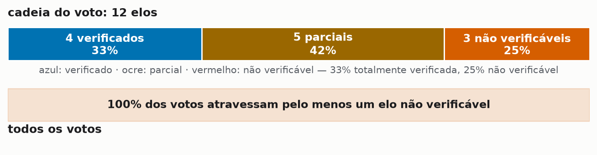
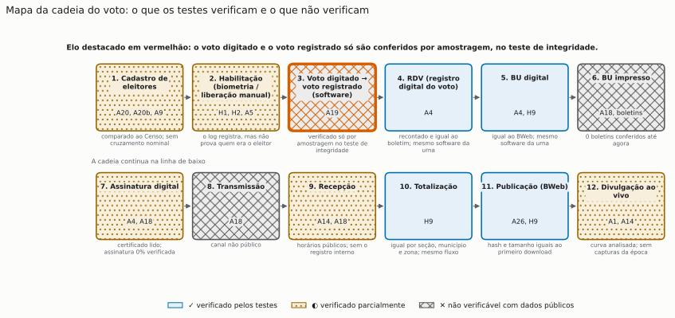
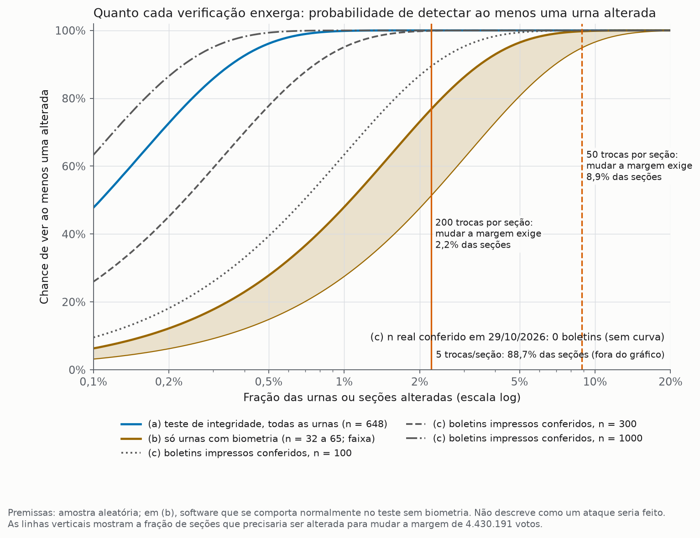
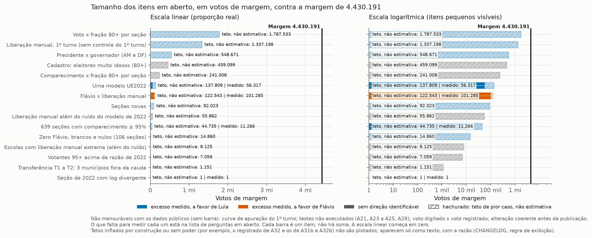
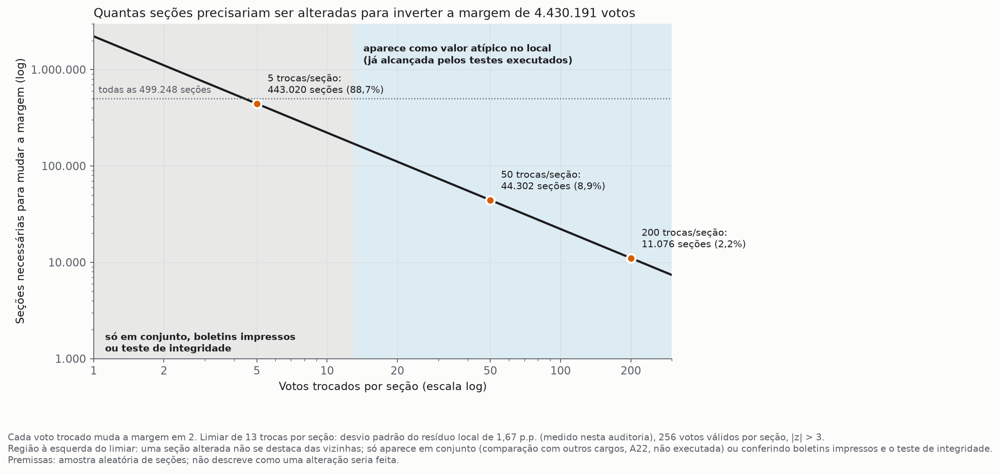

# Auditoria independente reproduzível: 2º turno presidencial de 2026

Esta é uma **auditoria independente**. Não é laudo, perícia oficial nem documento homologado: nenhum órgão homologou. Foi construída para que qualquer perito, de qualquer lado, repita cada número e conteste o que discordar.

> **Versão preliminar (v0.9.3).** A v1.0 sai depois do relatório consolidado do TCU sobre os testes de integridade (prazo até 24/11/2026), da verificação da assinatura criptográfica e de um lote inicial de boletins impressos conferidos ([como enviar](boletins-impressos.md)).

## O quanto da cadeia do voto a verificação pública cobre

<picture><source media="(max-width: 640px)" srcset="img/g0_verificacao_m.png"></picture>

- **33% da cadeia do voto totalmente verificada com dados públicos** (4 de 12 elos; [mapa completo, G1](#g1-mapa-da-cadeia-do-voto)).
- **25% não verificáveis** (3 de 12: voto digitado → registrado, boletim impresso conferido, transmissão).
- **100% dos votos atravessam pelo menos um elo não verificável.**
- **0 testes encontraram efeito capaz de alterar o resultado**; o maior teto de pior caso, não estimativa, é 40,35% da margem ([A20b](fase3.html#a20b)).

Isto não é evidência de nada, nem de um lado nem do outro: é o mapa de onde uma alteração passaria invisível aos dados públicos.

**[Envie a foto do seu boletim](boletins-impressos.html)**: pelo formulário de envio no GitHub.

## Os dois gatilhos mais óbvios, checados primeiro

Estes dois padrões pareciam o lugar óbvio onde uma alteração passaria barato; por isso foram testados primeiro, com os dados por seção.

<h3>Empates e margens de 1 voto</h3>
<ul>
<li><strong>2.150 seções com empate exato</strong> entre Lula e Flávio em 2026, com <strong>517.768 votos válidos</strong>; <strong>4.517 seções decididas por exatamente 1 voto</strong>, com <strong>1.087.289 votos</strong>.</li>
<li>Contra o nulo binomial por seção: empates observados 2.150 contra 2.337 esperados (razão 0,92); margens de 1 voto: 4.517 contra 4.672 (0,97). Em todas as faixas de margem de 0 a 10, 2026 fica <strong>abaixo do nulo</strong>, como 2022. O crescimento dos empates (+5,1%) é o do próprio número de seções (+5,7%).</li>
<li>Simetria das margens de 1 voto: 2.268 a favor de Lula e 2.249 a favor de Flávio (p = 0,789). Urna trocada nessas seções: na taxa nacional ou abaixo.</li>
<li><strong>Leitura:</strong> 2.150 urnas empatadas e 4.517 decididas por 1 voto concentram 1,6 milhão de votos onde <strong>nenhum dos dois lados pode construir vantagem</strong>. Se a estratégia fosse amarrar o placar urna a urna, o campo de atuação seria exatamente este. Os números não mostram sobra estatística (0,92 do esperado) nem direção (2.268 a 2.249; p = 0,789); e é justamente a ausência de sobra que exige explicação, porque urna pequena empatada não deixa rastro em teste de agregado. <strong>O que fecha: o boletim impresso dessas urnas, um a um.</strong></li>
</ul>

<h3>Nordeste: habilitação sem biometria e troca de urna</h3>
<ul>
<li>Correlação município a município (1.794 municípios, por taxa): Spearman ρ = 0,06, substancialmente zero; "as capitais têm os dois" é efeito de tamanho.</li>
<li>Seções com Lula ≥ 80% e (troca de urna ou município no top-10% de habilitação sem biometria): <strong>3.469 seções</strong> em 2026, saldo de 537.354 votos de margem, teto de 24,3% da margem; em 2022 o mesmo padrão era <strong>maior</strong> (3.766 seções, saldo 602.222, teto de 27,2%): é estrutural, não específico de 2026.</li>
<li>Oponente entre 0 e 10 votos: 3.029 seções em 2026 (saldo 376.149; 65% no Nordeste), contra 4.097 em 2022 (saldo 505.308; 73% no NE): o conjunto encolheu 26%.</li>
<li><strong>Leitura:</strong> o conjunto encolheu 26% desde 2022 e o padrão é maior em 2022. Pode ser estrutura; pode ser exatamente o que uma técnica em redução planejada deixaria. Com os dados internos não há como diferenciar uma coisa da outra; por isso estas seções seguem no topo da fila de verificação: <strong>as 190 com troca de urna e alta habilitação sem biometria pedem folha de votação e ata (pedido LAI 07 já protocolado)</strong>.</li>
</ul>

<h3>A hipótese que não dá para derrubar sozinha</h3>

Uma operação sofisticada reduziria as técnicas visíveis e introduziria outras, de propósito, de modo que cada teste isolado encontrasse "estrutura" ou "declínio". Com dados internos, essa hipótese não pode ser confirmada nem refutada: qualquer padrão observado é compatível com ela. O que a mantém em pé como pergunta, e o que a decidiria, são as âncoras externas: boletins impressos, teste de integridade, série histórica de pesquisas. <strong>Este cenário o dossiê não pode ver; só a verificação física pode.</strong>

Padrão refutado não fecha a pergunta; padrão estrutural, menos ainda. Quem quiser contestar os números tem os scripts e os dados aqui. Estes dois eram os gatilhos mais óbvios; os que restam abertos estão nas <a href="perguntas-em-aberto.html">Perguntas em aberto</a>.

Detalhamento e contas: [memorando exploratório](https://github.com/baduba/eleicoes-dossie-2026/blob/main/docs/propostas/gatilhos-e-inversao.md).

## A conta que não fecha: de onde vieram os votos do 2º turno

Em todo 2º turno desde 2002, os votos que cada finalista ganha têm que vir de algum lugar: dos eliminados alinhados, de quem votou branco ou nulo no 1º turno e do comparecimento novo. Em 2026, essa conta não fecha sem sobra.

<h3>O lado de Lula</h3>
<ul>
<li>Lula ganhou <strong>+10,38 milhões</strong> de votos entre o 1º e o 2º turno. As fontes naturalmente alinhadas explicam de 3,7 a 5,5 milhões. <strong>Sobram de +4,8 a +6,7 milhões sem fonte óbvia.</strong></li>
<li>Para fechar a conta sem sobra, seria preciso que <strong>90 a 99%</strong> dos votos de Cury, Caiado e Zema (6,42 milhões, todos com endosso declarado a Flávio) tivessem ido para Lula. Na série histórica, quando um eliminado endossa um finalista, cerca de 73% dos votos seguem o endosso (2014). Cross-over nessa escala não tem precedente em 2002-2022.</li>
</ul>

<h3>O outro lado, e os controles honestos</h3>
<ul>
<li>Espelho: Flávio ganhou só <strong>+3,72 milhões</strong>, tendo um pool de direita endossado de cerca de 8,9 milhões.</li>
<li>Desvios de 2 a 7 milhões entre esperado e observado aconteceram nas 7 eleições da série (2014 teve desvio maior ainda, contra o PT: -6,73 milhões). O que é sem precedente em 2026 não é o tamanho do desvio: é a <strong>direção e a composição</strong>. O finalista com o menor pool ganhou o maior volume, e o fechamento benigno exige comportamento eleitoral inédito.</li>
</ul>

Reconciliação com o teste municipal: as transições município a município já publicadas (A31) reproduzem exatamente nesta análise (f 2026: 0,7360 contra 0,7367 versionado). As duas leituras são consistentes; o fechamento nacional com pools ideológicos mede o que o municipal agnóstico não mede.

**Status:** análise **exploratória**; pré-registro A39 proposto (cross-over implícito x pesquisas de transferência do 2º turno de 2026); dados e script em `results/exploratorio/FLX_*` e `scripts/exploratorio/10_fechamento_fluxo.py`.

Uma conta que não fecha não é prova de nada: pode ser a maior onda eleitoral da série, e nenhum teste separa onda de operação com dados internos. Mas é a primeira vez que fechar a conta exige acreditar em algo que nunca aconteceu. O que decide não é este dossiê: é pesquisa de transferência de voto do 2º turno, folha de votação e boletim impresso. Enquanto isso não chega, a pergunta fica registrada.

## O que sabemos e o que ainda não sabemos

### Resultado verificado

- **Cadeia RDV, BU, BWeb e total:** 0 divergências nos testes executados (14.067 seções de 27 UFs com arquivos de urna; BWeb contra totalização por seção, município e zona).
- **Excesso medido somado:** cerca de 99 mil pró-Lula e 101 mil pró-Flávio (votos de margem), em sentidos opostos, contra a margem de 4.430.191 votos.
- **Votos depois das 17h:** cerca de 23 mil (contagem de votos, não votos de margem).
- **Limite:** esses testes comparam arquivos que o próprio TSE publica; não excluem uma alteração coerente feita antes da publicação nem verificam se o voto registrado é o digitado (ver as perguntas abaixo).

Se uma alteração acontecesse nos elos que não são publicados (o voto digitado, o boletim impresso, a transmissão), <strong>nenhum teste deste dossiê a veria</strong>. É por isso que as perguntas abaixo continuam abertas.

## Perguntas em aberto (resumo)

Há **32 perguntas em aberto**: resíduos sem causa identificada, hipóteses ainda não testadas e pontos cegos estruturais. O maior teto de pior caso, não estimativa, é 40,35% da margem (A20b). **Não são evidência de nada, nem de um lado nem do outro: são lacunas que só dados novos fecham.**

Lista completa, com situação, teto e o que fecharia cada uma: [Perguntas em aberto](perguntas-em-aberto.html).

## Onde uma falha poderia passar despercebida

Esta seção mostra, com números, onde a verificação pública termina e de que tamanho uma falha precisaria ser para mudar o resultado. Todo valor em votos está em votos de margem (variação da diferença Lula menos Flávio; trocar um voto muda a margem em 2).

### G1. Mapa da cadeia do voto

<picture><source media="(max-width: 640px)" srcset="img/g1_cadeia_m.svg"></picture>

**Em palavras simples:** o voto passa por doze etapas; os testes cobrem as etapas depois do registro; as etapas anteriores e as que ocorrem fora dos arquivos públicos ficam parcialmente verificadas ou não verificadas. **Técnico:** status por etapa a partir de A4, H9, A5, A18, A19, A20, A26; o elo voto digitado → voto registrado só é verificado por amostragem (teste de integridade). Como fechar esta lacuna: [boletins impressos](boletins-impressos.html) e [chave oficial da assinatura](a18-alteracao-no-meio.html#2).

### G2. Curvas de detecção

<picture><source media="(max-width: 640px)" srcset="img/g2_deteccao_m.png"></picture>

**Em palavras simples:** quanto maior o pedaço alterado, mais fácil é ver; os boletins impressos e o teste de integridade enxergam alterações pequenas que os testes estatísticos não enxergam. **Técnico:** probabilidade hipergeométrica de ver ao menos uma urna alterada; premissas: amostra aleatória; em (b), software que se comporta normalmente no teste sem biometria. Não descreve como um ataque seria feito. Como fechar esta lacuna: [enviar fotos de boletins](boletins-impressos.html), [pedido LAI 03](fase3.html#a28).

### G3. Tamanho do impacto dos itens em aberto

<picture><source media="(max-width: 640px)" srcset="img/g3_impacto_m.png"></picture>

**Em palavras simples:** cada item em aberto, desenhado ao lado da margem; o maior teto de pior caso é menor que a margem, e vários itens não têm número porque faltam dados. **Técnico:** barra sólida = excesso medido (estimativa central positiva); barra hachurada = teto de pior caso (placebo mais frouxo), em votos de margem; não há soma. Como fechar esta lacuna: [pedidos LAI](fase3.html#a28) e [lista de fiscais](fase3.html#a23).

### G4. Quantas seções precisariam ser alteradas

<picture><source media="(max-width: 640px)" srcset="img/g4_secoes_m.png"></picture>

**Em palavras simples:** quanto menos votos se trocam por seção, mais seções seriam necessárias, e mais difícil é ver uma seção sozinha. **Técnico:** seções = ⌈2.215.096 / trocas⌉; limiar de 13 trocas por seção = 3 desvios padrão do resíduo local (1,67 p.p.) com 256 votos válidos. Como fechar esta lacuna: [boletins impressos](boletins-impressos.html) e [comparação com outros cargos, A22](fase3.html#a22).

> **Estes gráficos mostram onde a verificação pública termina. Não indicam que houve falha; indicam onde uma falha não seria vista pelos dados disponíveis e o que seria preciso para vê-la.**

### O que não foi testado

Ver [Questões em aberto](residuos.md), [Pontos cegos](pontos-cegos.md), [Fase 3](fase3.md) e a lista de **NÃO EXECUTADO**: cruzamento com boletins impressos (0 conferidos; sem insumo), assinatura criptográfica da urna (certificado lido, assinatura 0% verificada), curva de divulgação do site Resultados, perfil de comparecimento de 2026/2º turno, 2014 na curva de apuração, as "472 urnas" do vídeo, e os testes A21 (parcial), A22, A23, A24 e A25 (parcial) da Fase 3.

## Como contribuir

- **Fotos de boletins impressos:** [página de coleta](boletins-impressos.html). Conferidos até 29/10/2026: 0.
- **Listas de seções com fiscal** (partidos e coligações): formato em [A23](fase3.html#a23).
- **Respostas de pedidos LAI:** textos prontos em [`lai/`](https://github.com/baduba/eleicoes-dossie-2026/tree/main/lai); envie a resposta por issue.
- **Código ou método alternativo:** abra uma issue ou um PR com um script reproduzível.
- **Contestação de qualquer número:** abra uma issue com o script e o valor esperado.

## O que foi feito
Análise estatística dos dados oficiais do TSE por seção (BWeb de 2014, 2018, 2022 e 2026, com hash conferido), mais os arquivos de urna (BU, RDV, assinatura e log) de uma amostra de 14.067 seções do 2º turno de 2026 e as mesmas seções em 2022 como placebo. Previsões foram registradas antes de cada bloco de análises ([Pré-registro](preregistro.md)); todo teste tem placebo e é simétrico; resultados nulos têm o mesmo destaque que os positivos.

## Resumo dos resultados (números sem adjetivos)
- **Totais e consistência:** Lula 64.256.232, Flávio 59.826.041, margem 4.430.191. O BWeb coincide com `votacao_secao` e com a totalização por zona em 2026.
- **Cadeia da urna (A4):** em 14.067 seções de 27 UFs, o BU digital coincide com o BWeb, o RDV recontado coincide com o BU e os hashes de BU, RDV, imagem e log constam na lista assinada pela urna: 0 divergências. **Isso verifica consistência entre arquivos que o TSE publica e não exclui uma alteração coerente feita antes da publicação** ([A18](a18-alteracao-no-meio.md)). A assinatura criptográfica em si **não foi verificada** (0% das seções; NÃO EXECUTADO PARCIAL: falta a chave oficial acessível).
- **Alteração no meio e voto digitado x registrado (A18, A19):** os atrasos documentados (1 hora no 1º turno; recebimento retido até as 19h no 2º) foram testados pela janela de relógio contra placebos, sem excesso detectado, mas esses testes não excluem uma alteração coerente. A correspondência entre voto digitado e voto registrado só é verificada por amostragem no teste de integridade, e o modelo atual não possui registro conferido pelo eleitor ([A19](a19-voto-digitado.md)). Fotos de boletins impressos podem ser enviadas por qualquer pessoa ([como enviar](boletins-impressos.md)).
- **Relatório original:** a tabela de fechamento (339.593 seções entre 17h01 e 17h15), as 8,6 milhões de liberações manuais (8.632.488) e os percentuais da Bahia reproduzem; as conclusões não se sustentam ([página](relatorio-original.md)).
- **Votos depois das 17h (A5):** estimativa a partir dos logs de 23.094 votos (contagem, não votos de margem) em todo o país (IC95 16.895 a 29.704), 0,52% da margem de 4.430.191 (comparação direta da contagem com a margem); muitas das seções que fecharam tarde ficaram abertas sem registrar voto depois das 17h.
- **Liberação manual:** caiu 14% de 2022 para 2026; a associação com o voto em Lula existe nos dois turnos de 2026 e não é específica do 2º turno.
- **Curva de apuração, conversão e zero voto (A1, A2, A3, A11, A12, A13, A14):** a curva real e seus trechos lineares ficam dentro da faixa das ordens geográficas simuladas; nenhuma conversão do oponente para o PT é necessária para explicar o resultado nacional; o "109 seções com zero voto" não reproduz (são 106 no 2º turno; 143 em 2022, 328 em 2018); às 19h34 só 7,8% dos BUs tinham sido recebidos, não 70%.
- **Linhas com ressalva de desenho (A1, A2, A3, A12):** pelos critérios pré-registrados, saíram com rótulo de excesso, mas **o mesmo teste acusa excesso em séries ou anos sem manipulação** (A1: 20 de 20 simulações limpas; A2: o PT de 2022; A3: coeficientes negativos em todos os anos; A12: 44% de simulações limpas). As versões corrigidas não mostram excesso. Resultado original e corrigido, lado a lado, em [Resultados da Fase 2](resultados-fase2.md) e [Questões em aberto](residuos.md).
- **Excesso medido, todos os resíduos somados** (votos de margem): **cerca de 99.499 pró-Lula e 101.285 pró-Flávio**, 2,2% e 2,3% da margem de 4.430.191, em sentidos opostos ([soma e leitura](residuos.md)).
- **Impacto agregado** (só testes sem ressalva de desenho; unidade: votos de margem; teto de pior caso, não estimativa): 38.394 votos de margem pró-Lula e 122.543 pró-Flávio, tetos de pior caso; com as versões corrigidas no lugar das originais, o resultado é o mesmo (nenhuma das quatro versões corrigidas mostra excesso). A margem é 4.430.191.
## Autoria
Projeto sem autoria nominal, mantido pela conta baduba no GitHub. Contato, correções e contestações por *issue* em https://github.com/baduba/eleicoes-dossie-2026/issues.
