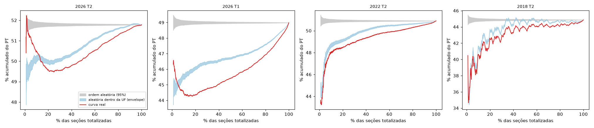
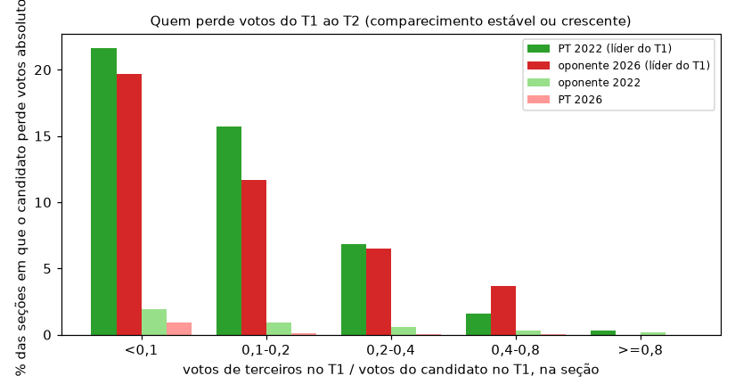
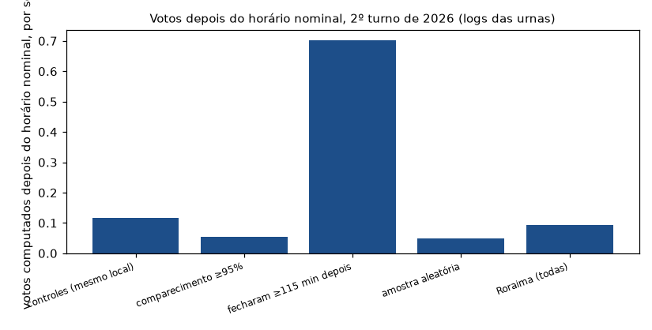
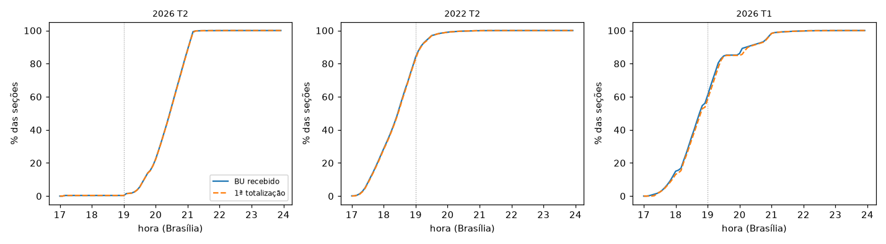

# Resultados da Fase 2 (A1 a A10)

Previsões, critérios e placebos foram registrados no [Adendo 4 do pré-registro](preregistro.md) **antes** de rodar as análises. O registro de testes é combinado com o da Fase 1 (38 testes); o p corrigido (Holm e Benjamini-Hochberg) é sobre a família completa. Veredito: regra do [Adendo 2](preregistro.md). Margem oficial: 4.430.191 votos. Tetos em votos são limites superiores sob causalidade, não estimativas.

**Leitura rápida.** Pelos critérios pré-registrados, três análises (A1, A2, A3) saem como "excesso detectado"; cada uma tem **ressalva de desenho** documentada, porque um controle posterior mostrou que o desenho pré-registrado media outra coisa (ver cada seção e [Changelog](changelog.md)). As linhas foram mantidas como saíram e os dois cálculos de impacto agregado (com e sem essas linhas) são publicados.

## Tabela-resumo

| A | analise | resultado | p_holm | pct_margem_pior_caso | veredito |
|---|---|---|---|---|---|
| A1 | curva de apuração | desvio máximo vs permutação dentro da UF: 2,65 p.p. (2026/T2) contra 1,76 (2026/T1), 1,17 (2022/T2), 1,33 (2018/T2) | 0,000 | n/d | EXCESSO DETECTADO (teste de forma, sem conversao em votos) |
| A2 | transições T1→T2 | oponente perde votos em 11,8% das seções (2022: PT 12,6%); forma do swing não difere dos placebos | 0,000 | n/d | EXCESSO DETECTADO (teste de forma, sem conversao em votos) |
| A3 | origem dos votos | contabilidade fecha por identidade; coeficiente ecológico não mede conversão | 0,002 | 211,86% | EXCESSO DETECTADO e relevante (pior caso >= 1% da margem) |
| A4 | cadeia da urna | 14.067 seções 2026: 0 divergências BU/RDV/hash | 1,000 | n/d | SEM EXCESSO (teste de forma, sem conversao em votos) |
| A5 | logs de urna | votos depois do horário nominal: estimativa nacional 23.094 (IC95 16.895 a 29.704) | 1,000 | 0,09% | REFUTADA (sem excesso, teto <1% da margem) |
| A6 | urna substituída | urna ≠ esperada em 0,60% das seções; sem efeito no voto | 1,000 | 0,00% | REFUTADA (sem excesso, teto <1% da margem) |
| A7 | pesquisas (contexto) | sem veredito; ver seção | n/d | n/d | contexto, sem veredito |
| A8 | coerência entre cargos | 0 seções fora da regra em 2018, 2022 e 2026 | 1,000 | n/d | SEM EXCESSO (teste de forma, sem conversao em votos) |
| A9 | perfil do comparecimento | só 1º turno; T1→T2 de 2026 NÃO EXECUTADO | 1,000 | n/d | SEM EXCESSO (teste de forma, sem conversao em votos) |
| A10 | modelo de urna, exterior | modelo de urna sem efeito no voto dentro do local | 1,000 | 3,11% | ver seção |

Todos os números abaixo vêm dos CSVs em `results/fase2/`; scripts em `scripts/`.

## A1. Curva de apuração

**Alegação testada:** "a curva deveria subir e descer em blocos; linhas retas indicam manipulação".

**Previsão registrada.** Sem manipulação: a curva real fica dentro do envelope de permutações das seções dentro de cada UF (mantida a sequência de UFs de chegada), e a soma final é idêntica em qualquer ordem. Critério: o desvio máximo (a partir de 1% das seções) só conta como excesso se superar o dos placebos e sair do envelope 95% simultâneo por 20 pontos consecutivos.

**Método.** Ordem real = horário da primeira totalização parcial por seção (`DT_PRIM_TOT_PARCIAL_HOR_TSE`). 1.000 ordens aleatórias totais (nulo A) e 1.000 permutações dentro de cada UF preservando a sequência de UFs (nulo B), sobre ~500 mil seções.

| ano | turno | secoes | share_final | maxdev_vs_B_pp | maxdev_vs_B_pp_posterior_ge10pct | maxdev_vs_A_pp | maior_sequencia_fora_envelope | fracao_explicada_por_geografia | pct_secoes_totalizadas_antes_das_19h |
|---|---|---|---|---|---|---|---|---|---|
| 2026 | 2 | 499.205 | 0,5179 | 2,65 | 0,61 | 2,32 | 861 | 0,828 | 0,37 |
| 2026 | 1 | 499.206 | 0,4899 | 1,76 | 1,74 | 4,73 | 942 | 0,881 | 58,43 |
| 2022 | 2 | 472.027 | 0,5090 | 1,17 | 0,74 | 7,65 | 988 | 0,914 | 83,01 |
| 2018 | 2 | 454.447 | 0,4487 | 1,33 | 1,12 | 10,21 | 957 | 0,913 | 88,47 |

**Resultado pré-registrado.** O desvio máximo de 2026/T2 contra o nulo B é 2,65 p.p., maior que o dos placebos (1,76, 1,17, 1,33), e a curva sai do envelope por 861 pontos consecutivos. Pelo critério fixado, a linha sai como **excesso detectado (teste de forma)**.

**Ressalva de desenho.** (1) O nulo B é rejeitado nos quatro anos (maior sequência fora do envelope: 861, 942, 988, 957 de 990 pontos): a ordem de chegada dentro da UF não é aleatória em nenhuma eleição, porque municípios e zonas chegam em blocos. (2) Em 2026/T2 o desvio máximo ocorre nos primeiros 1 a 5% das seções; a partir de 10% das seções ele cai a 0,61 p.p., abaixo dos placebos (1,74, 0,74, 1,12); esta é uma análise **posterior**, não pré-registrada. (3) A geografia explica 83% do desvio contra a ordem aleatória total. O efeito sobre a soma final é zero por construção.

**Pausa da divulgação.** Em 2026/T2, só 0,37% das seções tinham primeira totalização antes das 19h, contra 83,0% em 2022 e 88,5% em 2018. Isso é compatível com a pausa descrita pela imprensa (ver [Base legal](base-legal.md)); a fonte oficial não pôde ser aberta.

**Ordem de chegada por UF (2026/T2, posição mediana):** ZZ 0,00, DF 0,08, TO 0,10, PB 0,11, AM 0,14, MS 0,18 (primeiras); MG 0,56, PI 0,59, SP 0,66, BA 0,67, SE 0,84, RJ 0,88 (últimas). O PT tem SP 46%, BA 71%, SE 70%, RJ 47% nas últimas: estados com perfis diferentes chegam em momentos diferentes, e a curva reflete isso.

**NÃO EXECUTADO:** (i) 2014/T2: o produto `detalhe_votacao_secao` de 2014 não traz horário de totalização e o BWeb de 2014 só tem a data de recebimento; (ii) comparação numérica com o gráfico "Evolução da apuração" do g1 de 25/10/2026: o gráfico não foi fornecido como dado.

## A2. Transições seção a seção, 1º para 2º turno

**Alegação testada:** conversão de eleitores do oponente para o PT; compressão de margem ('113x30 vira 77x70'); formato do swing diferente do histórico.

**Previsão registrada.** Sem manipulação: frequência de perda de votos absolutos pelo oponente e forma do swing dentro da faixa dos anos placebo. Critério: frequência fora de [mín, máx] dos placebos, ou forma 'diferente' se a menor distância KS de 2026 a um placebo superar a maior distância entre pares de placebos.

**Perda de votos absolutos** em seções com comparecimento estável ou crescente (≥ 98% do T1):

| ano | cand | secoes_estaveis_ou_crescentes | secoes_com_perda | pct_secoes | votos_perdidos | pct_dos_votos_T1_do_cand_nessas_secoes | pct_secoes_perda_acima_de_20pct_do_T1 |
|---|---|---|---|---|---|---|---|
| 2014 | OPO | 219.370 | 2.428 | 1,11 | 9.604 | 0,049 | 0,043 |
| 2014 | PT | 219.370 | 7.368 | 3,36 | 36.618 | 0,174 | 0,054 |
| 2018 | OPO | 289.233 | 3.027 | 1,05 | 7.649 | 0,023 | 0,008 |
| 2018 | PT | 289.233 | 1.511 | 0,52 | 6.837 | 0,037 | 0,005 |
| 2022 | OPO | 391.919 | 4.938 | 1,26 | 11.131 | 0,025 | 0,005 |
| 2022 | PT | 391.919 | 49.243 | 12,56 | 187.733 | 0,398 | 0,018 |
| 2026 | OPO | 450.760 | 53.194 | 11,80 | 186.977 | 0,363 | 0,085 |
| 2026 | PT | 450.760 | 1.272 | 0,28 | 3.252 | 0,007 | 0,000 |

**Resultado pré-registrado:** o oponente perde votos em 11,8% das seções em 2026, fora da faixa dos placebos de oponente (2014, 2018, 2022: 1,1%, 1,0%, 1,3%). Pelo critério, **excesso detectado (teste de forma)**.

**Ressalva de desenho (análise posterior).** O placebo "por papel" (oponente) é inadequado: em 2022 foi o **PT**, que liderou o 1º turno, quem perdeu votos absolutos em 12,6% das seções, quase o espelho dos 11,8% do oponente em 2026 (que liderou o 1º turno). Nos dois anos havia poucos votos de terceiros para repartir (cerca de 10 milhões e 9 milhões, contra 26 milhões em 2014 e 2018). Por faixa de "votos de terceiros / votos do candidato no T1" na seção, as frequências são parecidas:

| cand | razao_terceiros_sobre_cand_T1 | 2014 | 2018 | 2022 | 2026 |
|---|---|---|---|---|---|
| OPO | 0,1-0,2 | 3.29 | 1.51 | 0.9 | 11.71 |
| OPO | 0,2-0,4 | 0.83 | 0.81 | 0.58 | 6.48 |
| OPO | 0,4-0,8 | 0.21 | 0.61 | 0.32 | 3.69 |
| OPO | <0,1 | 13.55 | 5.04 | 1.94 | 19.68 |
| OPO | >=0,8 | 0.03 | 0.53 | 0.21 | 0.0 |
| PT | 0,1-0,2 | 10.02 | 3.5 | 15.72 | 0.12 |
| PT | 0,2-0,4 | 4.22 | 1.07 | 6.84 | 0.05 |
| PT | 0,4-0,8 | 1.02 | 0.22 | 1.59 | 0.04 |
| PT | <0,1 | 17.29 | 8.14 | 21.64 | 0.89 |
| PT | >=0,8 | 0.11 | 0.01 | 0.31 | 0.0 |

**Forma do swing** (resíduo da margem do T2 sobre a margem do T1, com efeito fixo de município):

| par | ks | ad_subamostra_20k |
|---|---|---|
| 2014 x 2018 | 0,0210 | 12,8 |
| 2014 x 2022 | 0,1233 | 817,5 |
| 2014 x 2026 | 0,1097 | 638,6 |
| 2018 x 2022 | 0,1155 | 653,7 |
| 2018 x 2026 | 0,1018 | 491,3 |
| 2022 x 2026 | 0,0187 | 12,8 |

| menor_ks_2026_vs_placebo | maior_ks_entre_placebos | criterio_diferente |
|---|---|---|
| 0,0187 | 0,1233 | False |

Critério de forma: **2026 não difere** (a menor distância, contra 2022, é menor que a maior distância entre placebos). Os anos se agrupam em dois pares, {2014, 2018} e {2022, 2026}, e 2026 fica no par de 2022.

**Compressão de margem:** coeficiente da margem do T2 sobre a margem do T1 (com município):

| ano | spec | coef_m1 | ep | n | municipios |
|---|---|---|---|---|---|
| 2014 | margem T2 ~ margem T1 / municipio | 0,8242 | 0,0069 | 402.378 | 5.569 |
| 2018 | margem T2 ~ margem T1 / municipio | 0,7577 | 0,0050 | 427.448 | 5.568 |
| 2022 | margem T2 ~ margem T1 / municipio | 0,9146 | 0,0055 | 464.029 | 5.570 |
| 2026 | margem T2 ~ margem T1 / municipio | 0,9396 | 0,0025 | 491.114 | 5.571 |

## A3. Origem dos votos novos de Lula

**Contabilidade nacional (identidade).** Como no 2º turno não há terceiros, `ΔPT + ΔOPO = Δcomparecimento + terceiros no T1 − Δ(brancos e nulos)`. A identidade fecha em todas as eleições:

| ano | PT_T1 | PT_T2 | OPO_T1 | OPO_T2 | TERCEIROS_T1 | BN_T1 | BN_T2 | dPT | dOPO | dCOMP | pool | identidade_ok | pt_pct_do_pool | opo_pct_do_pool |
|---|---|---|---|---|---|---|---|---|---|---|---|---|---|---|
| 2014 | 43.267.668 | 54.501.118 | 34.897.211 | 51.041.155 | 25.858.923 | 11.098.775 | 7.141.606 | 11.233.450 | 16.143.944 | -2.438.698 | 27.377.394 | True | 41,0 | 59,0 |
| 2018 | 31.342.005 | 47.040.906 | 49.276.990 | 57.797.847 | 26.431.678 | 10.312.562 | 11.094.439 | 15.698.901 | 8.520.857 | -1.430.043 | 24.219.758 | True | 64,8 | 35,2 |
| 2022 | 57.259.504 | 60.345.999 | 51.072.345 | 58.206.354 | 9.897.870 | 5.452.648 | 5.700.443 | 3.086.495 | 7.134.009 | 570.429 | 10.220.504 | True | 30,2 | 69,8 |
| 2026 | 53.879.538 | 64.256.232 | 56.104.503 | 59.826.041 | 9.321.993 | 5.969.801 | 4.153.801 | 10.376.694 | 3.721.538 | 2.960.239 | 14.098.232 | True | 73,6 | 26,4 |

Em 2026, Lula ganhou 10.376.694 votos e o oponente 3.721.538 (líquido positivo): a soma dos dois (14.098.232) é exatamente o conjunto de votos disponíveis (14.098.232 = 2.960.239 de comparecimento + 9.321.993 de terceiros − -1.816.000 de variação de brancos e nulos). Nacionalmente, **nenhuma conversão do oponente para o PT é necessária** para explicar o resultado.

**Perda líquida mínima por seção** (quantos votos do T1 de cada candidato 'sumiram' dentro de seções onde ele perdeu votos absolutos; é limite inferior de eleitores que não repetiram o voto, por mudança, abstenção ou outra causa, não de conversão):

| ano | cand | secoes | secoes_com_perda_liquida | pct_secoes | votos_perdidos_liquidos_somados | ganho_liquido_nacional |
|---|---|---|---|---|---|---|
| 2014 | OPO | 428.854 | 8.366 | 1,95 | 38.639 | 16.143.944 |
| 2014 | PT | 428.854 | 33.361 | 7,78 | 254.395 | 11.233.450 |
| 2018 | OPO | 454.447 | 16.611 | 3,66 | 62.162 | 8.521.166 |
| 2018 | PT | 454.447 | 11.910 | 2,62 | 90.077 | 15.699.286 |
| 2022 | OPO | 472.027 | 14.700 | 3,11 | 52.955 | 7.134.009 |
| 2022 | PT | 472.027 | 88.977 | 18,85 | 458.860 | 3.086.495 |
| 2026 | OPO | 499.205 | 82.180 | 16,46 | 383.008 | 3.721.538 |
| 2026 | PT | 499.205 | 9.590 | 1,92 | 58.933 | 10.376.696 |

O oponente de 2026 (16,5% das seções, 383 mil votos) e o PT de 2022 (18,9%, 459 mil) têm o mesmo porte: o padrão é espelhado entre os anos e não identifica manipulação.

**Regressão ecológica** (taxas de transição aparentes; falácia ecológica: são correlações entre agregados, não comportamento individual). Coeficiente de "oponente no T1" sobre o PT no T2:

| ano | destino_T2 | origem_T1 | coef | ep |
|---|---|---|---|---|
| 2014 | PT | OPO_T1 | -0,070 | 0,006 |
| 2014 | PT | TERCEIROS_T1 | 0,393 | 0,017 |
| 2014 | PT | BRANCOS_NULOS_T1 | 0,430 | 0,052 |
| 2018 | PT | OPO_T1 | -0,098 | 0,012 |
| 2018 | PT | TERCEIROS_T1 | 0,703 | 0,029 |
| 2018 | PT | BRANCOS_NULOS_T1 | 0,288 | 0,041 |
| 2022 | PT | OPO_T1 | -0,045 | 0,002 |
| 2022 | PT | TERCEIROS_T1 | 0,433 | 0,011 |
| 2022 | PT | BRANCOS_NULOS_T1 | 0,256 | 0,020 |
| 2026 | PT | OPO_T1 | -0,034 | 0,002 |
| 2026 | PT | TERCEIROS_T1 | 0,465 | 0,011 |
| 2026 | PT | BRANCOS_NULOS_T1 | 0,756 | 0,016 |

Com efeito fixo de município (relativo à abstenção do T1):

| ano | origem_T1 | coef | ep | municipios | nota |
|---|---|---|---|---|---|
| 2014 | op1 | -0,042 | 0,005 | 5570 | relativo a abstencao T1; EF de municipio |
| 2018 | op1 | -0,065 | 0,005 | 5570 | relativo a abstencao T1; EF de municipio |
| 2022 | op1 | -0,069 | 0,003 | 5570 | relativo a abstencao T1; EF de municipio |
| 2026 | op1 | -0,127 | 0,004 | 5571 | relativo a abstencao T1; EF de municipio |

**Resultado pré-registrado:** o coeficiente de 2026 (-0,034) é o menos negativo dos quatro anos, e a linha sai como **excesso detectado e relevante** pelo teto calculado (211,86% da margem). **Ressalva de desenho:** todos os coeficientes são negativos (nenhum mede conversão); a diferença entre anos reflete geografia; com efeito fixo de município o coeficiente de 2026 é o **mais negativo** (−0,127 contra −0,042 a −0,070). O teto em votos derivado dessa diferença não tem interpretação causal. Por isso o H10 é publicado com e sem esta linha.

**Limites:** falácia ecológica; o 2º turno de 2026 tem eleitores de candidatos diferentes dos de 2022; a identidade usa o BWeb, que é o mesmo dado que se audita.

## A4. Cadeia da urna até o TSE

**Insumo:** conjunto "arquivos transmitidos para totalização" (BU, imagem do BU, RDV, log e assinatura por seção). O catálogo do TSE lista só o 1º turno; os arquivos do 2º turno de 2026 e os de 2022 existem nos mesmos caminhos e foram baixados por seção (requisições parciais).

**Previsão registrada.** 0 divergências entre BU digital, RDV, BWeb e vínculo de hash em toda a amostra; divergência de um voto é reportada individualmente.

**Amostra:** Roraima inteira; as seções que fecharam ≥115 min depois do horário (população completa fora de Roraima e do exterior); controles 1:1 no mesmo local; as seções com comparecimento ≥95%; 60 aleatórias por UF; e as mesmas seções em 2022 como placebo.

| ano | secoes | secoes_com_erro_de_leitura | UFs | bu_diferente_do_bweb | rdv_diferente_do_bu | hash_nao_vinculado | versoes_software | assin_app_falhas_no_log |
|---|---|---|---|---|---|---|---|---|
| 2026 | 14.067 | 0 | 27 | 0 | 0 | 0 | 10.23.0.0 - Praia da Barra do Cahy (14067) | 0 |
| 2022 | 12.554 | 0 | 27 | 0 | 0 | 0 | 8.26.0.0 - Onça-pintada (12554) | 0 |

**O que foi verificado:** (c) o BU digital coincide com o BWeb em Lula, oponente, brancos, nulos e comparecimento; (b) o RDV recontado coincide com o BU (Lula, oponente, brancos e total; nulos pelo resíduo); vínculo de integridade: o SHA-512 de BU, RDV, imagem e log consta na lista assinada pela urna e o SHA-512 da lista confere com o hash do bloco assinado. A emissão do BU coincide com a do BWeb em 14.067 de 14.067 seções.

**NÃO verificado:** (a) a assinatura criptográfica em si: a chave da urna usa uma curva de 521 bits com OID 1.3.6.1.4.1.44588.2.1, sem suporte em bibliotecas padrão, e a especificação ASN.1 e os scripts de exemplo do TSE não são acessíveis por automação (HTTP 403). Insumo que falta: especificação e ferramenta oficial de verificação. (d) a identificação do software contra a publicada na lacração: só foi possível listar a versão registrada no log (2026: 10.23.0.0; 2022: 8.26.0.0) e a verificação de assinatura de aplicação por etapa (6 etapas, todas "SUCESSO" em todos os logs lidos). Insumo que falta: hashes de lacração para comparar.

**Divergências individuais:**

Nenhuma em 2026 nem em 2022.

O leitor de BU e RDV é genérico (decodificador BER) e cada campo foi validado contra o BWeb antes de ser usado (em Roraima: 1.519 de 1.519 seções).

## A5. Logs de urna (votos depois do horário)

**O que os logs registram** (confirmado nos arquivos): por eleitor, "Eleitor foi habilitado", "Tipo de habilitação" (biométrica ou manual, com "Dado digitado confere"), "Voto confirmado para [cargo]" e "O voto do eleitor foi computado", cada um com data e hora; eventos de contingência e de verificação de assinatura.

**Previsão registrada.** Votos computados no log = comparecimento do BU em ≥99,9% das seções; votos depois do horário nominal concentrados nas seções que fecharam tarde; intervalos entre votos acima do mínimo físico; sem associação entre voto tardio e Lula% no mesmo local além do placebo de 2022.

**Log contra BU:**

| ano | secoes | votos_computados_log_igual_comparecimento | pct | divergentes | divergentes_com_urna_de_contingencia | divergentes_sem_contingencia | habilitado_maior_que_comparecimento | habilitado_menor_que_comparecimento | gap_minimo_entre_habilitacoes_s | secoes_com_gap_menor_10s |
|---|---|---|---|---|---|---|---|---|---|---|
| 2026 | 14.067 | 14.005 | 99,56 | 62 | 62 | 0 | 256 | 62 | 18.0 | 0 |
| 2022 | 12.554 | 12.462 | 99,27 | 92 | 91 | 1 | 585 | 91 | 13.0 | 0 |

O limiar de 99,9% pré-registrado **não é atingido** (ver `pct`), e todas as divergências com contingência explicam a diferença: urnas de contingência assumiram no meio do dia (log: "Seção informada pelo operador: 0000 - Urna de contingência"), e o BU consolida os votos recuperados da urna anterior, que não estão no log da urna substituta. Exceções **sem** contingência (reportadas individualmente):

| ano | uf | cd_municipio | zona | secao | comparecimento | computado_log | habilitado_log |
|---|---|---|---|---|---|---|---|
| 2022 | RJ | 60011 | 7 | 479 | 348 | 347 | 348 |

**Votos computados depois do horário nominal de fechamento** (17h de Brasília, convertido ao relógio local de cada urna), por estrato:

| ano | estrato | secoes | secoes_com_voto_apos_nominal | votos_apos_nominal | media_por_secao | max_por_secao | comparecimento |
|---|---|---|---|---|---|---|---|
| 2026 | C | 3.675 | 378 | 429 | 0,117 | 4 | 1.064.563 |
| 2026 | H | 619 | 21 | 34 | 0,055 | 14 | 105.661 |
| 2026 | L | 6.714 | 3.169 | 4.710 | 0,702 | 39 | 1.970.400 |
| 2026 | R | 1.540 | 69 | 76 | 0,049 | 2 | 381.492 |
| 2026 | RR_completo | 1.519 | 133 | 143 | 0,094 | 2 | 308.597 |
| 2022 | C | 3.414 | 478 | 539 | 0,158 | 6 | 1.039.604 |
| 2022 | H | 209 | 8 | 57 | 0,273 | 46 | 40.515 |
| 2022 | L | 6.268 | 901 | 1.098 | 0,175 | 14 | 1.940.256 |
| 2022 | R | 1.395 | 96 | 119 | 0,085 | 5 | 351.855 |
| 2022 | RR_completo | 1.268 | 145 | 169 | 0,133 | 4 | 286.269 |

**Último voto por seção, depois do horário nominal:**

| ano | estrato | secoes | ultimo_voto_mais_de_15min_apos | ultimo_voto_mais_de_60min_apos | ultimo_voto_antes_do_horario_nominal |
|---|---|---|---|---|---|
| 2026 | C | 3675 | 0 | 0 | 3297 |
| 2026 | H | 619 | 1 | 0 | 598 |
| 2026 | L | 6714 | 2599 | 1629 | 3542 |
| 2026 | R | 1540 | 0 | 0 | 1471 |
| 2026 | RR_completo | 1519 | 0 | 0 | 1386 |
| 2022 | C | 3414 | 1 | 0 | 2935 |
| 2022 | H | 209 | 1 | 1 | 200 |
| 2022 | L | 6268 | 3 | 0 | 5365 |
| 2022 | R | 1395 | 2 | 0 | 1299 |
| 2022 | RR_completo | 1268 | 0 | 0 | 1123 |

**Estimativa nacional (2026/T2).** Nas 6.714 seções que fecharam ≥115 min depois (população completa fora de Roraima e exterior; 6.714 medidas, 0 sem arquivo), foram medidos 4.710 votos depois do horário nominal. Nas demais seções, a amostra aleatória (60 por UF) estima 18.384 votos (IC95 12.185 a 24.994). **Total estimado: 23.094 votos (IC95 16.895 a 29.704)**, ou 0,52% da margem. A referência externa de 34.330 eleitores (imprensa, não verificada) está dentro da mesma ordem de grandeza. Esses votos incluem os de eleitores com senha na fila às 17h, previstos no art. 153 do Código Eleitoral ([Base legal](base-legal.md)); a maior parte está fora das seções que fecharam tarde.

**Leitura.** Muitas das seções que "fecharam tarde" ficaram com a urna aberta até perto das 19h **sem registrar voto depois das 17h**: a coluna "último voto antes do horário nominal" mostra quantas. O fechamento tardio, por si, não mede voto tardio.

**Liberação manual total pelo log** (comparecimento menos habilitações biométricas), contra o campo do BWeb (que só mede quem tinha biometria cadastrada):

| secoes | manual_total_log | bweb_biom_nh | razao | tipos_de_habilitacao |
|---|---|---|---|---|
| 13.986 | 464.424 | 242.091 | 1,92 | hab_biométrica |

**Associação entre voto tardio e Lula% no mesmo local** (fração de votos depois do horário nominal; controle do T1; placebo: mesmas seções em 2022):

| ano | coef | ep | secoes | locais |
|---|---|---|---|---|
| 2026 | 0,060 | 0,068 | 11.403 | 1.822 |
| 2022 | -0,093 | 0,122 | 10.410 | 1.692 |

Veredito: REFUTADA (sem excesso, teto <1% da margem).

**Limites:** amostra, não toda a eleição (as seções de UFs sem arquivo e os controles não são aleatórios); o relógio da urna é local; o log não permite ligar voto a eleitor. Gap mínimo entre habilitações: 13 s.

## A6. Urna substituída ou em contingência

Compara a urna **esperada** (correspondência esperada do TSE, 24/10/2026) com a **efetivada** (BWeb). Não há conjunto aberto de "ocorrências" no catálogo do TSE; esta é a medida disponível.

| ano | secoes | sem_correspondencia | urna_diferente_da_esperada | pct |
|---|---|---|---|---|
| 2026 | 497.696 | 12 | 3.005 | 0,60 |
| 2022 | 470.843 | 23 | 8.078 | 1,72 |

| ano | spec | coef | ep | secoes_substituidas | n |
|---|---|---|---|---|---|
| 2026 | Lula% T2 / T1 | -0,0007 | 0,0004 | 3.005 | 475.772 |
| 2026 | comparecimento T2 / T1 | -0,0003 | 0,0004 | 3.005 | 475.772 |
| 2026 | Lula% T1 (mesmas secoes, sem lag) | 0,0003 | 0,0008 | 3.005 | 475.772 |
| 2022 | Lula% T2 / T1 | 0,0001 | 0,0002 | 8.078 | 447.198 |
| 2022 | comparecimento T2 / T1 | -0,0006 | 0,0002 | 8.078 | 447.198 |
| 2022 | Lula% T1 (mesmas secoes, sem lag) | 0,0006 | 0,0005 | 8.078 | 447.198 |

Seções com urna diferente da esperada não votam diferente das vizinhas do mesmo local, em 2026 nem em 2022.

## A7. Pesquisas e resultado (contexto, sem veredito)

O TSE publica o **registro** das pesquisas (protocolo, instituto, datas, amostra, custo), não os resultados; os resultados abaixo vêm da imprensa, com link. Erro de pesquisa não é evidência de manipulação, e o inverso também vale.

| ano | instituto | divulgacao | pt_pct_validos_pesquisa | oponente_pct_validos_pesquisa | margem_erro_declarada_pp | fonte | pt_pct_validos_resultado | erro_pp_pt | fora_da_margem_declarada |
|---|---|---|---|---|---|---|---|---|---|
| 2018 | Datafolha | 2018-10-27 | 45.0 | 55.0 | 2 | https://www.jornalopcao.com.br/ultimas-noticias/datafolha-bolsonaro-tem-55-e-haddad-45-dos-votos-validos-145482/ | 44,87 | 0,13 | False |
| 2022 | Datafolha | 2022-10-29 | 52.0 | 48.0 | 2 | https://www.opovo.com.br/eleicoes-2022/2022/10/29/pesquisa-datafolha-lula-52-bolsonaro-48-no-2-turno.html | 50,90 | 1,10 | False |
| 2026 | Datafolha | 2026-10-24 | 49.0 | 51.0 | 2 | https://www.jornalopcao.com.br/ultimas-noticias/flavio-bolsonaro-tem-51-dos-votos-validos-contra-49-de-lula-no-segundo-turno-aponta-datafolha-879307/ | 51,79 | -2,79 | True |
| 2026 | AtlasIntel | 2026-10-24 | 49.2 | 50.8 | 1 | https://www.bloomberglinea.com.br/brasil/flavio-bolsonaro-tem-508-dos-votos-validos-contra-492-de-lula-aponta-atlasintel/ | 51,79 | -2,59 | True |

Registros do TSE com divulgação em 24/10/2026 (Datafolha e AtlasIntel) estão em `data/pesquisas_registro_tse_24out2026.csv`; o vínculo entre cada resultado e cada número de registro **não foi verificado**.

**NÃO EXECUTADO:** erro histórico dos mesmos institutos em 2014 (não foi localizada, com fonte, uma pesquisa de véspera com data confirmada) e de Quaest e Paraná Pesquisas em 2026 (resultado não localizado).

## A8. Coerência entre cargos no mesmo boletim

Em cada seção, o total de cada cargo (nominais + legenda + brancos + nulos + anulados) deve ser igual ao comparecimento (vezes o número de vagas: 2 no Senado de 2018 e 2026).

| ano | turno | cargos | secoes_x_cargos | fora_da_regra |
|---|---|---|---|---|
| 2018 | 1 | 10 | 2.270.038 | 0 |
| 2018 | 2 | 2 | 732.741 | 0 |
| 2022 | 1 | 7 | 2.356.075 | 0 |
| 2022 | 2 | 2 | 721.067 | 0 |
| 2026 | 1 | 7 | 2.490.804 | 0 |
| 2026 | 2 | 2 | 538.944 | 0 |

Zero seções fora da regra em 2018, 2022 e 2026 (1º turno com todos os cargos; 2º turno com presidente e governador nos estados com segundo turno). Uma inserção que mexesse em um só cargo quebraria a igualdade.

## A9. Perfil do comparecimento

**NÃO EXECUTADO (parte):** a variação do 1º para o 2º turno por faixa etária em 2026 não pode ser calculada: o conjunto de perfil de comparecimento e abstenção de 2026 foi publicado em 21/10/2026 e só tem o 1º turno. Insumo que falta: o perfil de 2026/2º turno.

**Executado:** consistência das células e totais; comparação do 1º turno de 2026 com 2022 e 2018; variação T1→T2 de 2018 e 2022 (contexto).

| ano | turno | celulas | comparecimento_maior_que_aptos | comp_mais_abst_diferente_de_aptos | facultativo_obrigatorio_soma_diferente |
|---|---|---|---|---|---|
| 2018 | 1 | 1.625.513 | 0 | 0 | 0 |
| 2018 | 2 | 1.625.513 | 0 | 0 | 0 |
| 2022 | 1 | 1.667.245 | 0 | 0 | 0 |
| 2022 | 2 | 1.667.245 | 0 | 0 | 0 |
| 2026 | 1 | 1.648.478 | 0 | 0 | 0 |

| ano | turno | zonas_pareadas | so_bweb | so_perfil | zonas_comp_diferente | zonas_aptos_diferente | soma_abs_dif_comp |
|---|---|---|---|---|---|---|---|
| 2018 | 1 | 6.240 | 0 | 33 | 5.475 | 5.520 | 114.415 |
| 2018 | 2 | 6.240 | 0 | 33 | 5.426 | 5.511 | 106.841 |
| 2022 | 1 | 6.240 | 0 | 43 | 6.093 | 6.097 | 363.117 |
| 2022 | 2 | 6.241 | 0 | 42 | 6.077 | 6.108 | 316.643 |
| 2026 | 1 | 6.251 | 0 | 41 | 6.099 | 6.097 | 325.657 |

Nenhuma célula com comparecimento maior que aptos. A diferença por zona entre perfil e BWeb vem de eleitores que votam fora da zona de cadastro; o total nacional coincide (diferença de poucos milhares em ~125 milhões).

**Zonas com comparecimento facultativo fora de [Q1−3 IQR, Q3+3 IQR] de 2022/T1:**

| ano | turno | zonas | fora_do_intervalo | pct | acima | abaixo | limites |
|---|---|---|---|---|---|---|---|
| 2022 | 1 | 6169 | 1 | 0.016210082671421624 | 0 | 1 | [0.016, 1.059] |
| 2022 | 2 | 6169 | 1 | 0.016210082671421624 | 0 | 1 | [0.016, 1.059] |
| 2018 | 1 | 6162 | 0 | 0.0 | 0 | 0 | [0.016, 1.059] |
| 2018 | 2 | 6162 | 0 | 0.0 | 0 | 0 | [0.016, 1.059] |
| 2026 | 1 | 6188 | 0 | 0.0 | 0 | 0 | [0.016, 1.059] |

O intervalo é largo (o teste é pouco sensível). **Aptos e comparecimento por faixa etária, 1º turno** (2026 contra 2022):

| DS_FAIXA_ETARIA | aptos_2018 | comp_2018 | aptos_2022 | comp_2022 | aptos_2026 | comp_2026 | aptos_2026_sobre_2022 | comp_2026_sobre_2022 |
|---|---|---|---|---|---|---|---|---|
| 16 anos | 403.683 | 345.012 | 815.063 | 682.824 | 606.603 | 539.705 | 1 | 1 |
| 17 anos | 996.934 | 819.501 | 1.301.718 | 1.071.822 | 1.027.641 | 887.283 | 1 | 1 |
| 60 a 64 anos | 8.907.997 | 7.645.176 | 9.995.705 | 8.728.897 | 11.164.875 | 9.801.480 | 1 | 1 |
| 70 a 74 anos | 4.763.343 | 2.630.591 | 5.885.358 | 3.591.058 | 6.968.531 | 4.792.544 | 1 | 1 |
| 75 a 79 anos | 3.170.195 | 1.188.659 | 3.858.345 | 1.613.326 | 4.767.219 | 2.489.816 | 1 | 2 |
| 80 a 84 anos | 1.972.721 | 475.944 | 2.424.573 | 654.036 | 2.748.727 | 1.020.461 | 1 | 2 |
| 85 a 89 anos | 1.121.775 | 148.709 | 1.334.866 | 209.870 | 1.466.444 | 356.317 | 1 | 2 |
| 90 a 94 anos | 689.078 | 33.697 | 738.761 | 49.783 | 665.199 | 89.557 | 1 | 2 |

O comparecimento de eleitores acima de 80 anos (voto facultativo) cresce mais que os aptos na faixa entre 2022 e 2026 no 1º turno. Causa não identificada (hipóteses não testadas: revisão do cadastro e cancelamentos de títulos). É uma hipótese mundana plausível para parte do aumento de seções com comparecimento ≥95% (ver [Resíduos](residuos.md)).

## A10. Modelo de urna, exterior e locais especiais

**Modelo da urna, dentro do mesmo local** (coeficientes de Lula% no T2 dado o T1, contra a UE2020; UE2022 é modelo novo em 2026):

| ano | modelo | spec | coef | ep | secoes |
|---|---|---|---|---|---|
| 2022 | 2009 | Lula% T2 dado T1 | -0,0009 | 0,0011 | 46.159 |
| 2022 | 2010 | Lula% T2 dado T1 | -0,0008 | 0,0011 | 92.781 |
| 2022 | 2011 | Lula% T2 dado T1 | -0,0008 | 0,0011 | 26.432 |
| 2022 | 2013 | Lula% T2 dado T1 | -0,0008 | 0,0012 | 24.294 |
| 2022 | 2015 | Lula% T2 dado T1 | -0,0007 | 0,0011 | 85.159 |
| 2026 | 2013 | Lula% T2 dado T1 | 0,0007 | 0,0015 | 11.421 |
| 2026 | 2015 | Lula% T2 dado T1 | -0,0000 | 0,0014 | 87.179 |
| 2026 | 2022 | Lula% T2 dado T1 | 0,0000 | 0,0002 | 198.670 |

Nenhum modelo de urna altera o voto dentro do mesmo local. A taxa de liberação manual muda muito por modelo (ver Fase 1, seção 3.3), mas não o voto.

**Exterior (ZZ) contra Brasil:**

| ano | turno | recorte | secoes | pt_pct_dos_dois | comparecimento | pct_secoes_comparecimento_ge95 |
|---|---|---|---|---|---|---|
| 2018 | 1 | exterior (ZZ) | 744 | 14,67 | 40,6 | 0,000 |
| 2018 | 1 | Brasil | 453.702 | 38,92 | 79,8 | 0,211 |
| 2018 | 2 | exterior (ZZ) | 744 | 28,98 | 40,2 | 0,000 |
| 2018 | 2 | Brasil | 453.703 | 44,90 | 78,8 | 0,111 |
| 2022 | 1 | exterior (ZZ) | 1.014 | 53,13 | 43,9 | 0,000 |
| 2022 | 1 | Brasil | 471.010 | 52,85 | 79,2 | 0,056 |
| 2022 | 2 | exterior (ZZ) | 1.017 | 51,28 | 44,6 | 0,000 |
| 2022 | 2 | Brasil | 471.010 | 50,90 | 79,6 | 0,049 |
| 2026 | 1 | exterior (ZZ) | 1.309 | 52,24 | 37,3 | 0,000 |
| 2026 | 1 | Brasil | 497.897 | 48,98 | 79,2 | 0,112 |
| 2026 | 2 | exterior (ZZ) | 1.308 | 53,85 | 41,6 | 0,000 |
| 2026 | 2 | Brasil | 497.897 | 51,78 | 81,0 | 0,128 |

O exterior tem 0 seções com comparecimento ≥95% em todas as eleições; as causas mundanas dos ≥95% no Brasil (locais indígenas, prisionais, quilombolas, seções pequenas e novas) estão na seção 3.6 da Fase 1. Estação de geração da carga (`CD_FLASHCARD`) **não foi analisada**.

## A11. Transferência de votos dos derrotados no 1º turno

**Contexto com fonte.** Zema, Caiado e Cury apoiaram Flávio no 2º turno e Renan Santos liberou os eleitores ([A Crítica](https://acritica.net/eleicoes-2026/caiado-zema-e-cury-apoiam-flavio-no-2o-turno-renan-santos-libera-eleitores/); Caiado: [Diário do Nordeste](https://diariodonordeste.verdesmares.com.br/pontopoder/ronaldo-caiado-anuncia-apoio-a-flavio-bolsonaro-no-2-turno-das-eleicoes-2026-1.3796893)). Os apoios de Clariana Barão, Hertz Dias, Edmilson Costa e Samara Martins e a posição de Rui Costa Pimenta foram informados ao autor desta auditoria, mas **não foi localizada fonte**; os blocos seguem a classificação informada e isso está declarado.

**Votos de cada candidato no 1º turno, confirmados no BWeb:**

| numero | candidato | votos_t1 |
|---|---|---|
| 30 | Zema | 326.488 |
| 55 | Caiado | 2.605.148 |
| 70 | Cury | 3.448.569 |
| 27 | Clariana | 40.043 |
| 16 | Hertz Dias | 43.103 |
| 21 | Edmilson Costa | 22.693 |
| 80 | Samara Martins | 122.911 |
| 14 | Renan Santos | 2.675.887 |
| 29 | Rui Costa Pimenta | 15.024 |
| 35 | Wilson Grassi | 16.881 |
| 28 | Leonardo Alves | 5.246 |
| 13 | Lula | 53.879.538 |
| 22 | Flavio Bolsonaro | 56.104.503 |

**Contabilidade nacional, termo a termo** (identidade: ganho de Lula + ganho de Flávio = terceiros + queda de brancos e nulos + queda de abstenção + variação de aptos):

| termo | votos |
|---|---|
| terceiros no T1: bloco pro_Flavio | 6.420.248 |
| terceiros no T1: bloco esquerda | 188.707 |
| terceiros no T1: bloco Renan | 2.675.887 |
| terceiros no T1: bloco PCO | 15.024 |
| terceiros no T1: bloco outros | 22.127 |
| terceiros no T1: total (inclui outros nao listados) | 9.321.993 |
| queda de brancos e nulos (T1 menos T2) | 1.816.000 |
| queda de abstencao (T1 menos T2; aptos quase constantes) | 2.960.269 |
| mudanca no total de aptos (T2 menos T1) | -30 |
| SOMA dos termos (pool) | 14.098.262 |
| ganho de Lula (T2 menos T1) | 10.376.694 |
| ganho de Flavio (T2 menos T1) | 3.721.538 |
| ganho de Lula + ganho de Flavio | 14.098.232 |
| residuo (pool menos ganhos) | 30 |

A identidade fecha com resíduo zero. Os terceiros do 1º turno (9,32 milhões), a queda de brancos e nulos (1,82 milhão) e a queda de abstenção (2,96 milhões) somam 14,10 milhões, e os dois candidatos ganharam 14,10 milhões. O bloco que apoiou Flávio somou 6.420.248 votos no 1º turno, e o ganho **líquido** de Flávio foi 3.721.538.

**Regressão ecológica com efeito fixo de município** (voto por apto no T2 sobre a fatia de cada bloco no T1; abstenção omitida; falácia ecológica: são taxas aparentes entre agregados):

| ano | destino | origem | coef | ep | municipios |
|---|---|---|---|---|---|
| 2026 | PT | pro_Flavio | 0,305 | 0,013 | 5.571 |
| 2026 | PT | esquerda | 0,683 | 0,021 | 5.571 |
| 2026 | PT | Renan | 0,236 | 0,007 | 5.571 |
| 2026 | PT | PCO | 0,068 | 0,080 | 5.571 |
| 2026 | PT | outros | 0,275 | 0,050 | 5.571 |
| 2026 | PT | PT | 0,896 | 0,008 | 5.571 |
| 2026 | PT | OPO | -0,128 | 0,004 | 5.571 |
| 2026 | PT | BN | 0,506 | 0,019 | 5.571 |
| 2026 | OPO | pro_Flavio | 0,397 | 0,008 | 5.571 |
| 2026 | OPO | esquerda | 0,000 | 0,020 | 5.571 |
| 2026 | OPO | Renan | 0,286 | 0,008 | 5.571 |
| 2026 | OPO | PCO | 0,384 | 0,049 | 5.571 |
| 2026 | OPO | outros | 0,221 | 0,039 | 5.571 |
| 2026 | OPO | PT | -0,062 | 0,005 | 5.571 |
| 2026 | OPO | OPO | 0,947 | 0,002 | 5.571 |
| 2026 | OPO | BN | 0,025 | 0,017 | 5.571 |

**Goodman com restrição 0 a 1** (sem efeito fixo, ponderado; 2026):

| destino | origem | taxa_restrita_0_1 |
|---|---|---|
| PT | pro_Flavio | 0,357 |
| PT | esquerda | 0,994 |
| PT | Renan | 0,357 |
| PT | PCO | 0,563 |
| PT | outros | 0,484 |
| PT | PT | 1,000 |
| PT | OPO | 0,000 |
| PT | BN | 0,792 |
| PT | ABS | 0,067 |
| OPO | pro_Flavio | 0,455 |
| OPO | esquerda | 0,037 |
| OPO | Renan | 0,368 |
| OPO | PCO | 0,493 |
| OPO | outros | 0,140 |
| OPO | PT | 0,000 |
| OPO | OPO | 1,000 |
| OPO | BN | 0,000 |
| OPO | ABS | 0,000 |

**Heterogeneidade entre UFs** do coeficiente "bloco de origem → PT" (2026: bloco pró-Flávio; 2022 e 2018: maior terceiro, sem inferir apoios):

| ano | regressor | ufs | media_ponderada | dp_entre_ufs | min | max |
|---|---|---|---|---|---|---|
| 2026 | pro_Flavio | 24 | 0,313 | 0,072 | 0,232 | 0,567 |
| 2022 | terc1_n15 | 24 | 0,405 | 0,061 | 0,270 | 0,579 |
| 2018 | terc1_n12 | 24 | 0,708 | 0,102 | 0,514 | 0,848 |

**Resultado pré-registrado:** REFUTADA (sem excesso, teto <1% da margem) (coeficiente de 2026 0,305 contra 2022: maior terceiro (terc1_n15): 0.42089 (ep 0.00686, p_exc 1) | 2018: maior terceiro (terc1_n12): 0.70891 (ep 0.01825, p_exc 1)). **Ressalva de desenho:** os blocos de 2026 e os maiores terceiros de 2022 e 2018 têm composição diferente, e coeficientes ecológicos não medem conversão individual; o veredito aponta quando o coeficiente sai da faixa dos placebos, não que haja transferência indevida. A previsão "o ganho de Flávio cresce com a fatia do bloco que o apoiou" é testada pelo coeficiente bloco pró-Flávio → Flávio na tabela acima.

## A12. Seções com zero voto para um candidato

**Alegação testada:** "109 seções com zero voto". A origem do número não foi informada e nenhuma reportagem foi localizada; por isso reporto todas as definições razoáveis.

| ano | turno | definicao | secoes | zero_oponente | zero_PT | votos_PT_nas_zero_oponente | votos_oponente_nas_zero_PT |
|---|---|---|---|---|---|---|---|
| 2026 | 1 | todas as apuradas | 499.206 | 81 | 8 | 9.549 | 507 |
| 2026 | 1 | sem exterior, comparecimento >= 1 | 497.897 | 79 | 8 | 9.542 | 507 |
| 2026 | 2 | todas as apuradas | 499.205 | 106 | 4 | 14.860 | 296 |
| 2026 | 2 | sem exterior, comparecimento >= 1 | 497.897 | 106 | 4 | 14.860 | 296 |
| 2022 | 1 | todas as apuradas | 472.024 | 161 | 1 | 17.531 | 58 |
| 2022 | 1 | sem exterior, comparecimento >= 1 | 471.010 | 160 | 1 | 17.527 | 58 |
| 2022 | 2 | todas as apuradas | 472.027 | 143 | 4 | 16.455 | 124 |
| 2022 | 2 | sem exterior, comparecimento >= 1 | 471.010 | 141 | 2 | 16.418 | 118 |
| 2018 | 1 | todas as apuradas | 454.446 | 674 | 32 | 72.102 | 1.223 |
| 2018 | 1 | sem exterior, comparecimento >= 1 | 453.702 | 674 | 28 | 72.102 | 1.147 |
| 2018 | 2 | todas as apuradas | 454.447 | 328 | 4 | 36.608 | 315 |
| 2018 | 2 | sem exterior, comparecimento >= 1 | 453.703 | 328 | 3 | 36.608 | 275 |
| 2014 | 1 | todas as apuradas | 428.853 | 709 | 17 | 64.924 | 197 |
| 2014 | 1 | sem exterior, comparecimento >= 1 | 427.937 | 709 | 16 | 64.924 | 190 |
| 2014 | 2 | todas as apuradas | 428.854 | 194 | 13 | 15.103 | 199 |
| 2014 | 2 | sem exterior, comparecimento >= 1 | 427.936 | 192 | 10 | 15.103 | 192 |

**O 109 não reproduz** em nenhuma definição testada: em 2026/T2 são 106 seções com zero voto para Flávio e 4 para Lula; no 1º turno, 81 e 8. Para comparação, o oponente teve zero voto em 143 seções em 2022 (Bolsonaro), 328 em 2018 e 192 em 2014 (2º turno).

**Número esperado de seções com zero** = soma de P(zero) = (1 − p)^n, com p estimado de duas formas:

| ano | candidato_com_zero | estimador_de_p | secoes | observado | esperado | razao | z | p_excesso |
|---|---|---|---|---|---|---|---|---|
| 2026 | oponente | p da propria secao no T1 | 497.897 | 106 | 95,7 | 1,11 | 1,33 | 0,092 |
| 2026 | oponente | p das secoes vizinhas do local | 450.683 | 14 | 13,2 | 1,06 | 0,31 | 0,377 |
| 2026 | PT | p da propria secao no T1 | 497.897 | 4 | 7,2 | 0,56 | -1,59 | 0,944 |
| 2026 | PT | p das secoes vizinhas do local | 450.683 | 0 | 0,0 | 0,00 | -0,03 | 0,512 |
| 2022 | oponente | p da propria secao no T1 | 471.010 | 141 | 196,8 | 0,72 | -5,02 | 1,000 |
| 2022 | oponente | p das secoes vizinhas do local | 422.400 | 10 | 8,7 | 1,16 | 0,54 | 0,295 |
| 2022 | PT | p da propria secao no T1 | 471.010 | 2 | 1,9 | 1,03 | 0,05 | 0,478 |
| 2022 | PT | p das secoes vizinhas do local | 422.400 | 0 | 0,0 | 0,00 | -0,07 | 0,528 |
| 2018 | oponente | p da propria secao no T1 | 453.703 | 328 | 625,8 | 0,52 | -15,57 | 1,000 |
| 2018 | oponente | p das secoes vizinhas do local | 401.664 | 29 | 30,1 | 0,96 | -0,26 | 0,603 |
| 2018 | PT | p da propria secao no T1 | 453.703 | 3 | 33,8 | 0,09 | -6,21 | 1,000 |
| 2018 | PT | p das secoes vizinhas do local | 401.664 | 0 | 0,9 | 0,00 | -1,08 | 0,859 |
| 2014 | oponente | p da propria secao no T1 | 427.936 | 192 | 722,3 | 0,27 | -25,29 | 1,000 |
| 2014 | oponente | p das secoes vizinhas do local | 371.997 | 2 | 7,0 | 0,29 | -2,20 | 0,986 |
| 2014 | PT | p da propria secao no T1 | 427.936 | 10 | 8,4 | 1,19 | 0,63 | 0,266 |
| 2014 | PT | p das secoes vizinhas do local | 371.997 | 0 | 0,3 | 0,00 | -0,56 | 0,712 |

Em 2026 o observado para o oponente (106) fica próximo do esperado pelo voto da própria seção no T1 e pelos vizinhos do mesmo local, sem excesso significativo; em 2022, 2018 e 2014 o observado ficou **abaixo** do esperado pelo estimador do T1 (em 2018 e 2014 a presença de terceiros relevantes no T1 torna esse estimador pouco adequado).

**Perfil das 106 seções com zero voto para Flávio no 2º turno:** comparecimento mediano 128, aptos mediano 161; 53% tinham voto de Flávio no 1º turno, 36% de Bolsonaro em 2022 e 25% em 2018 (para as seções que existiam). **Teto:** os votos do PT nessas seções somam 14.860, ou 0,34% da margem. Tipo de local:

| tipo_local | secoes |
|---|---|
| escola_outro | 55 |
| indigena | 41 |
| rural_comunidade | 7 |
| prisional | 2 |
| quilombola | 1 |

A lista seção a seção (UF, município, local, tipo, aptos, comparecimento, resultado em 2026 T1, 2022 e 2018, liberação manual, encerramento, modelo de urna) está em `results/fase2/A12_a12_secoes_zero_2026.csv`.

**Veredito:** excesso detectavel, magnitude irrelevante (<1% da margem).

## A13. Curva de apuração: inversões, trechos lineares e o "método do vídeo"

O vídeo do Prof. Marcelo Trindade, os dados e o código das "472 urnas" **não foram fornecidos**; não foi localizada fonte sobre ele. Para essa parte: **NÃO REPRODUZÍVEL**. O que se testa é a alegação geral sobre a forma da curva, com a série reconstruída da ordem de totalização. Como precedente, um vídeo de 2014 com argumento parecido foi examinado por [Agência Pública (O Truco)](https://apublica.org/2018/10/video-falso-diz-eleicoes-2014-fora-fraudadas/) e [Aos Fatos](https://www.aosfatos.org/noticias/bolsonaro-promete-provas-de-fraude-mas-apresenta-alegacoes-ja-desmentidas-sobre-urnas-eletronicas/); a checagem observou que o trecho usado tinha 0,13% dos votos apurados.

**Método.** Inversão de liderança = mudança de sinal da margem acumulada entre os pontos a partir de 1% das seções. Trecho linear = janela de 5% das seções com R² ≥ 0,99 e variação ≥ 0,15 p.p. do share. Comparação com 1.000 ordens aleatórias (A) e 1.000 ordens geográficas realistas (B: embaralha dentro da UF mantendo a sequência de UFs). "Método do vídeo" (interpretação declarada no pré-registro): somar só os incrementos positivos da curva de share.

| medida | 2026 T2 | 2026 T1 | 2022 T2 | 2018 T2 |
|---|---|---|---|---|
| ano | 2026 | 2026 | 2022 | 2018 |
| turno | 2 | 1 | 2 | 2 |
| secoes | 499205 | 499206 | 472027 | 454447 |
| inversoes_real | 2 | 0 | 3 | 0 |
| inversoes_A_ic95 | (0.0, 0.0) | (0.0, 0.0) | (0.0, 0.0) | (0.0, 0.0) |
| inversoes_B_ic95 | (3.0, 15.049999999999955) | (0.0, 0.0) | (1.0, 5.0) | (0.0, 0.0) |
| inversoes_B_media | 7.876 | 0.0 | 3.598 | 0.0 |
| janelas_lineares_real | 41 | 172 | 0 | 0 |
| janelas_lineares_A_ic95 | (0.0, 0.0) | (0.0, 0.0) | (0.0, 0.0) | (0.0, 0.0) |
| janelas_lineares_B_ic95 | (22.0, 65.0) | (154.0, 195.0) | (0.0, 0.0) | (0.0, 0.0) |
| trechos_lineares_real | 4 | 6 | 0 | 0 |
| emenda_subidas_share_final_real | 0.6469425603523131 | 0.5397041884725373 | 0.6814467158844435 | 0.9051426023024175 |
| emenda_subidas_B_ic95 | (0.588, 0.606) | (0.52, 0.538) | (0.63, 0.662) | (0.8, 0.825) |
| emenda_subidas_A_ic95 | (0.532, 0.55) | (0.505, 0.524) | (0.524, 0.542) | (0.468, 0.491) |
| share_final | 0.517851828842626 | 0.4898850552326951 | 0.5090240511717216 | 0.44869768719969416 |
| lider_final | PT | oponente | PT | oponente |

**Inversões de liderança:** 2026 T2: 2 (ordens geográficas: (3.0, 15.049999999999955)); 2026 T1: 0 (ordens geográficas: (0.0, 0.0)); 2022 T2: 3 (ordens geográficas: (1.0, 5.0)); 2018 T2: 0 (ordens geográficas: (0.0, 0.0)). Nenhuma das eleições disponíveis teve exatamente uma virada, e 2026/T2 teve menos viradas que a média das ordens geográficas simuladas. Em ordem aleatória total não há virada alguma (a curva fica no valor final), o que mostra que as viradas vêm da geografia de chegada.

**Trechos lineares reais de 2026 e as UFs que chegaram naquele intervalo:**

| ano | turno | de_pct_secoes | ate_pct_secoes | variacao_share_pp | ufs_dominantes |
|---|---|---|---|---|---|
| 2026 | 2 | 61,3 | 67,8 | 0,31 | SP 30%, BA 12%, MG 11% |
| 2026 | 2 | 69,5 | 75,3 | 0,19 | SP 33%, MG 13%, BA 10% |
| 2026 | 2 | 88,3 | 94,7 | 0,19 | SP 29%, RJ 27%, BA 12% |
| 2026 | 2 | 89,9 | 94,9 | 0,15 | RJ 30%, SP 27%, BA 12% |
| 2026 | 1 | 66,8 | 72,1 | 0,30 | SP 27%, MG 13%, RJ 11% |
| 2026 | 1 | 70,8 | 76,3 | 0,31 | SP 28%, MG 13%, RJ 10% |
| 2026 | 1 | 72,0 | 77,3 | 0,31 | SP 26%, MG 13%, RJ 10% |
| 2026 | 1 | 73,0 | 78,5 | 0,38 | SP 24%, MG 13%, RJ 11% |
| 2026 | 1 | 75,2 | 80,7 | 0,33 | SP 25%, MG 14%, RJ 12% |
| 2026 | 1 | 79,8 | 99,3 | 1,91 | SP 17%, RJ 13%, BA 13% |

Os trechos lineares reais estão dentro da faixa simulada (janelas lineares reais contra intervalo das ordens geográficas, na tabela) e coincidem com a chegada de SP, BA, MG e RJ.

**O método de emendar subidas** produz "vitória" também em séries sem manipulação: em 2026/T2 dá 64,7% ao PT na série real e (0.588, 0.606) (fração) nas ordens geográficas sem manipulação, contra o resultado de 51,8%; em 2018 dá 90,5% ao Haddad, que perdeu com 44,9%.

**O total final independe da ordem** (idêntico em todas as permutações) e coincide com a soma dos BUs e com a totalização oficial (H9).

**NÃO EXECUTADO:** 2014 (sem horário de totalização no produto de 2014) e 2002 a 2010 (sem dado por seção com horário no catálogo aberto); snapshots do site Resultados; as "472 urnas" do vídeo.

## A14. Recebimento, totalização e divulgação em 25/10/2026

**Alegação:** "70% das urnas apuradas às 19h34, liberadas aos poucos". O vídeo original não foi fornecido; a captura mencionada sugere 7,28%.

| ano | turno | hora | pct_bu_recebido | pct_totalizado | max |
|---|---|---|---|---|---|
| 2026 | 2 | 17:30 | 0,38 | 0,38 | n/d |
| 2026 | 2 | 18:00 | 0,38 | 0,38 | n/d |
| 2026 | 2 | 19:00 | 0,38 | 0,38 | n/d |
| 2026 | 2 | 19:34 | 7,77 | 7,74 | n/d |
| 2026 | 2 | 20:00 | 22,44 | 22,29 | n/d |
| 2026 | 2 | 21:00 | 88,63 | 88,25 | n/d |
| 2026 | 2 | 22:00 | 99,98 | 99,98 | n/d |
| 2026 | 2 | atraso recebimento -> 1a totalizacao (min): mediana / p95 / max | 0,40 | 0,77 | 112,6 |
| 2022 | 2 | 17:30 | 8,04 | 7,65 | n/d |
| 2022 | 2 | 18:00 | 28,72 | 28,25 | n/d |
| 2022 | 2 | 19:00 | 84,14 | 83,04 | n/d |
| 2022 | 2 | 19:34 | 97,30 | 97,23 | n/d |
| 2022 | 2 | 20:00 | 98,98 | 98,96 | n/d |
| 2022 | 2 | 21:00 | 99,89 | 99,89 | n/d |
| 2022 | 2 | 22:00 | 99,99 | 99,99 | n/d |
| 2022 | 2 | atraso recebimento -> 1a totalizacao (min): mediana / p95 / max | 0,60 | 1,15 | 940,1 |
| 2026 | 1 | 17:30 | 2,39 | 2,34 | n/d |
| 2026 | 1 | 18:00 | 15,04 | 13,15 | n/d |
| 2026 | 1 | 19:00 | 60,83 | 58,46 | n/d |
| 2026 | 1 | 19:34 | 85,15 | 84,94 | n/d |
| 2026 | 1 | 20:00 | 86,14 | 84,96 | n/d |
| 2026 | 1 | 21:00 | 98,30 | 98,21 | n/d |
| 2026 | 1 | 22:00 | 99,75 | 99,75 | n/d |
| 2026 | 1 | atraso recebimento -> 1a totalizacao (min): mediana / p95 / max | 1,92 | 7,38 | 34,0 |

Em 2026/T2, às 19h34, **7,77%** dos BUs tinham sido recebidos e **7,74%** tinham a primeira totalização (a captura com 7,28% é do mesmo porte). Os 70% só foram atingidos depois das 20h (cerca de 20h45). O atraso entre recebimento e primeira totalização é curto e estável (mediana de menos de 1 minuto; p95 de menos de 1 minuto em 2026/T2), ou seja, **não há acúmulo de BUs recebidos e não totalizados**. Em 2022/T2, 84% dos BUs já estavam recebidos às 19h, e em 2026/T1, 61%.

**Explicação oficial da pausa:** a decisão do STF foi divulgada às 17h03, o ofício do TSE aos TREs saiu às 17h49, e a divulgação foi interrompida com 0,25% das seções totalizadas e retomada após as 19h (imprensa; ver [Base legal](base-legal.md)). Os dados são compatíveis: 0,38% das seções totalizadas antes das 19h.

**NÃO EXECUTADO:** a curva de **divulgação** (e o atraso totalizado → divulgado): não há snapshots públicos do site Resultados com horário. Insumo que falta: capturas com horário do site Resultados ou dados do próprio sistema.

## A15. Modelo de urna em 2022 (alegação do relatório do PL / Cerimedo)

O texto do relatório não foi fornecido; replica-se a alegação como foi resumida (modelos antigos favoreciam Lula). Contra UE2020, dentro do mesmo local, em 2022:

| ano | modelo | especificacao | coef_pp | ep_pp | secoes | votos_margem | votos_ic95_inf | votos_ic95_sup | pct_margem |
|---|---|---|---|---|---|---|---|---|---|
| 2022 | UE2009 | T2 sem controle do T1 (corte transversal) | 0,208 | 0,295 | 46.159 | 46.479 | -82.288 | 175.246 | 1,05 |
| 2022 | UE2010 | T2 sem controle do T1 (corte transversal) | 0,208 | 0,294 | 92.781 | 92.445 | -163.287 | 348.178 | 2,09 |
| 2022 | UE2011 | T2 sem controle do T1 (corte transversal) | 0,171 | 0,298 | 26.432 | 21.411 | -51.977 | 94.800 | 0,48 |
| 2022 | UE2013 | T2 sem controle do T1 (corte transversal) | 0,287 | 0,300 | 24.294 | 33.113 | -34.757 | 100.983 | 0,75 |
| 2022 | UE2015 | T2 sem controle do T1 (corte transversal) | 0,235 | 0,293 | 85.159 | 97.518 | -140.529 | 335.565 | 2,20 |
| 2022 | UE2009 | T2 com voto do T1 como controle | -0,088 | 0,113 | 46.159 | -19.629 | -69.185 | 29.927 | -0,44 |
| 2022 | UE2010 | T2 com voto do T1 como controle | -0,079 | 0,113 | 92.781 | -35.085 | -133.155 | 62.985 | -0,79 |
| 2022 | UE2011 | T2 com voto do T1 como controle | -0,081 | 0,114 | 26.432 | -10.161 | -38.294 | 17.972 | -0,23 |
| 2022 | UE2013 | T2 com voto do T1 como controle | -0,081 | 0,117 | 24.294 | -9.359 | -35.726 | 17.008 | -0,21 |
| 2022 | UE2015 | T2 com voto do T1 como controle | -0,069 | 0,113 | 85.159 | -28.735 | -120.288 | 62.818 | -0,65 |
| 2022 | UE2009 | T1 (corte transversal) | 0,353 | 0,301 | 46.159 | 78.700 | -53.044 | 210.445 | 1,78 |
| 2022 | UE2010 | T1 (corte transversal) | 0,342 | 0,301 | 92.781 | 151.822 | -110.736 | 414.381 | 3,43 |
| 2022 | UE2011 | T1 (corte transversal) | 0,300 | 0,306 | 26.432 | 37.586 | -37.696 | 112.869 | 0,85 |
| 2022 | UE2013 | T1 (corte transversal) | 0,438 | 0,307 | 24.294 | 50.562 | -18.941 | 120.066 | 1,14 |
| 2022 | UE2015 | T1 (corte transversal) | 0,362 | 0,300 | 85.159 | 150.302 | -93.540 | 394.143 | 3,39 |

Sem controle do 1º turno (a especificação que a alegação pressupõe), o efeito de UE2009 e UE2010 é positivo para Lula, mas pequeno e **não distinguível de zero** (intervalo de 95% inclui zero); o mesmo ocorre no próprio 1º turno (corte transversal), o que indica composição das seções que usam cada modelo. **Com o voto do 1º turno como controle, o efeito é negativo e não significativo** (−0,09 p.p.). Em 2026:

| ano | modelo | especificacao | coef_pp | ep_pp | secoes | votos_margem | votos_ic95_inf | votos_ic95_sup | pct_margem |
|---|---|---|---|---|---|---|---|---|---|
| 2026 | UE2013 | T2 sem controle do T1 (corte transversal) | 0,906 | 0,312 | 11.421 | 51.143 | 16.579 | 85.708 | 1,15 |
| 2026 | UE2015 | T2 sem controle do T1 (corte transversal) | 0,679 | 0,305 | 87.179 | 298.507 | 35.526 | 561.488 | 6,74 |
| 2026 | UE2022 | T2 sem controle do T1 (corte transversal) | -0,041 | 0,043 | 198.670 | -40.671 | -124.497 | 43.154 | -0,92 |
| 2026 | UE2013 | T2 com voto do T1 como controle | 0,071 | 0,148 | 11.421 | 4.026 | -12.393 | 20.445 | 0,09 |
| 2026 | UE2015 | T2 com voto do T1 como controle | -0,000 | 0,145 | 87.179 | -142 | -125.019 | 124.734 | -0,00 |
| 2026 | UE2022 | T2 com voto do T1 como controle | 0,003 | 0,021 | 198.670 | 3.230 | -37.374 | 43.834 | 0,07 |
| 2026 | UE2013 | T1 (corte transversal) | 1,009 | 0,334 | 11.421 | 56.977 | 19.966 | 93.987 | 1,29 |
| 2026 | UE2015 | T1 (corte transversal) | 0,822 | 0,328 | 87.179 | 361.143 | 78.437 | 643.849 | 8,15 |
| 2026 | UE2022 | T1 (corte transversal) | -0,054 | 0,046 | 198.670 | -53.087 | -141.287 | 35.112 | -1,20 |

Em 2026 nenhum modelo difere da UE2020 dentro do mesmo local.

## Impacto agregado (H10 combinado)

| criterio | sentido | n_testes_com_votos | n_sobreviventes | soma_votos_sobreviventes_exigente | soma_votos_sobreviventes_pior_caso | maximo_individual_pior_caso | soma_de_todos_exigente | pct_margem_sobreviventes_pior_caso | pct_margem_soma_todos_exigente |
|---|---|---|---|---|---|---|---|---|---|
| como registrado | PT | 29 | 3 | 1.853.448 | 9.425.488 | 9.385.617 | 2.239.567 | 212,76 | 50,55 |
| como registrado | OPO | 1 | 1 | 122.543 | 122.543 | 122.543 | 122.543 | 2,77 | 2,77 |
| excluindo linhas com ressalva de desenho | PT | 29 | 1 | 38.394 | 38.394 | 9.385.617 | 2.239.567 | 0,87 | 50,55 |
| excluindo linhas com ressalva de desenho | OPO | 1 | 1 | 122.543 | 122.543 | 122.543 | 122.543 | 2,77 | 2,77 |

Sobreviventes (Holm < 0,05) e a ressalva de cada um:

| Unnamed: 0 | H | teste | sentido | p_holm | votos_max_margem | votos_max_pior_caso | pct_pior_caso | veredito | ressalva |
|---|---|---|---|---|---|---|---|---|---|
| 6 | H1 | S1 Flavio/Bolsonaro votos/apto | OPO | 0,000 | 122.543 | 122.543 | 2,77% | EXCESSO DETECTADO e relevante (pior caso >= 1% da margem) | nan |
| 9 | H2 | delta voto Lula (2022->2026) ~ delta taxa manual, T2 | PT | 0,000 | 38.394 | 38.394 | 0,87% | excesso detectavel, magnitude irrelevante (<1% da margem) | nan |
| 25 | A3 | ecologica: fracao de eleitores do oponente no T1 que aparece como voto no PT no T2 | PT | 0,002 | 1.814.194 | 9.385.617 | 211,86% | EXCESSO DETECTADO e relevante (pior caso >= 1% da margem) | coeficientes negativos em todos os anos (nao medem conversao); com EF de municipio o coeficiente de 2026 e o mais negativo (analise posterior) |
| 35 | A12 | secoes com zero voto para o oponente no T2: razao observado/esperado (p do T1) | PT | 0,025 | 860 | 1.478 | 0,03% | excesso detectavel, magnitude irrelevante (<1% da margem) | os placebos tem razao observado/esperado abaixo de 1 porque o estimador de p pelo T1 e inadequado onde ha terceiros relevantes no T1 (2018, 2014); o teste direto observado contra esperado em 2026 (z=1,33) nao e significativo (analise posterior) |

Os tetos não são aditivos independentes e os sentidos PT e oponente não se compensam.

## NÃO EXECUTADO (resumo)

| teste | motivo |
|---|---|
| A1/A1 2014/T2 | o produto detalhe_votacao_secao de 2014 nao tem DT_RECEBIMENTO_BU_HOR_TSE nem DT_PRIM_TOT_PARCIAL_HOR_TSE; o BWeb de 2014 so tem a data (sem hora) de recebimento |
| A7/A7 2014 e demais institutos | nao foi localizada, com fonte, uma pesquisa final de 2014 com data confirmada; Quaest e Paraná Pesquisas de 24/10/2026 nao foram localizadas com resultado; o TSE publica so o registro das pesquisas, sem resultados |
| A9/A9 T1->T2 2026 | o perfil de comparecimento e abstencao de 2026 foi publicado em 21/10/2026 e so tem o 1o turno; a variacao T1->T2 por faixa etaria nao pode ser calculada |
| A11/A11 UF 2026 AP | amostra insuficiente para y_PT ~ ['x_pro_Flavio', 'x_esquerda', 'x_Renan', 'x_PCO', 'x_outros', 'x_PT', 'x_OPO', 'x_BN'] / mun: n=1914 |
| A11/A11 UF 2026 RR | amostra insuficiente para y_PT ~ ['x_pro_Flavio', 'x_esquerda', 'x_Renan', 'x_PCO', 'x_outros', 'x_PT', 'x_OPO', 'x_BN'] / mun: n=1519 |
| A11/A11 UF 2022 AP | amostra insuficiente para y_PT ~ ['x_terc1_n15', 'x_terc2_n12', 'x_outros_terc', 'x_PT', 'x_OPO', 'x_BN'] / mun: n=1740 |
| A11/A11 UF 2022 RR | amostra insuficiente para y_PT ~ ['x_terc1_n15', 'x_terc2_n12', 'x_outros_terc', 'x_PT', 'x_OPO', 'x_BN'] / mun: n=1268 |
| A11/A11 UF 2018 AP | amostra insuficiente para y_PT ~ ['x_terc1_n12', 'x_terc2_n45', 'x_outros_terc', 'x_PT', 'x_OPO', 'x_BN'] / mun: n=1632 |
| A11/A11 UF 2018 RR | amostra insuficiente para y_PT ~ ['x_terc1_n12', 'x_terc2_n45', 'x_outros_terc', 'x_PT', 'x_OPO', 'x_BN'] / mun: n=1171 |
| A13/A13 2014/T2 e 2002-2010 | o produto detalhe_votacao_secao de 2014 nao tem horario de totalizacao e nao ha dado por secao com horario para 2002 a 2010 no catalogo aberto |
| A13/A13 video 'Prof. Marcelo Trindade' (472 urnas, 60-65%) | NAO REPRODUZIVEL: o video, os dados e o codigo das '472 urnas' nao foram fornecidos |
| A13/A13/A14 snapshots do site Resultados | nao ha serie publica de snapshots do site Resultados com horario; so o horario de totalizacao por secao |
| A14/A14 curva de divulgacao e atraso totalizado->divulgado | nao ha snapshots publicos do site Resultados com horario; e o video original, onde a captura sugere 7,28%, nao foi fornecido |
| BU | NaoExecutado: teste direto com boletins impressos: nenhuma foto/PDF de BU foi fornecido (nem em Downloads, nem no projeto). Envie imagens com o QR code visivel ou uma planilha zona;secao;turno;votos para o cruzamento com o BWeb. Divergencia de qualquer tamanho sera reportada. |

